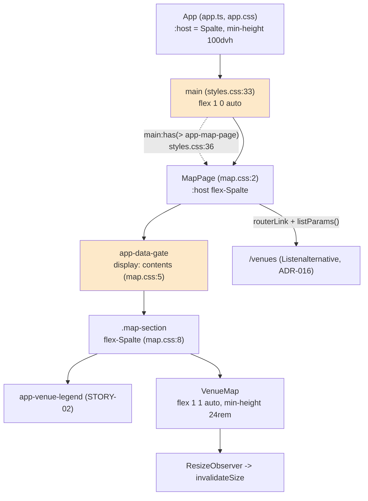
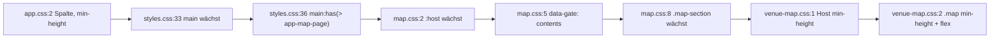

# Architektur-Analyse: SERVICE-10-STORY-01 – Karte über die gesamte Fläche, ohne Ortsliste

**Ticket:** SERVICE-10 (Story SERVICE-10-STORY-01)  
**Analysiert:** 2026-10-29  
**Scope:** Dateien der Story im Branch-Diff gegen main: `web/src/app/app.ts`, `app.css`, `app.spec.ts`, `web/src/styles.css`, `pages/map/*`, `shared/venue-map/*` (ResizeObserver, Layout), `web/tools/quality/smoke.mjs` (Abschnitt `/map`)  
**Status:** Entwurf – wartet auf Abnahme  
**Berücksichtigte ADRs / Gherkin:** ADR-002, ADR-004, ADR-016 (übrige ADRs gelesen, ohne Bezug) / `web/karte.feature`; EARS `web/karte.md`, Quality `web/karte-darstellung.md`, `PIPELINE.md` (Annahmen)

Hinweis zum Maßstab: Die Skill-Vorlage verweist auf ADR-Nummern eines anderen Projekts (ADR-004 Signals, ADR-022 usw.). Hier gelten die ADRs des Repos; Signals/Zoneless/Standalone/`loadComponent` (ADR-002) wurden geprüft.

---

## 1. Executive Summary

| Kriterium | Bewertung |
|---|---|
| Gesamtarchitektur-Score | 8 / 10 |
| Architektur-Reifegrad | Hoch (für die Größe des Projekts) |
| Komponentenorientierung | Stark |
| Wartbarkeit | Hoch |
| Testbarkeit | Hoch |
| Technische Schuld | Gering |
| ADR-Konformität | vollständig konform (0 Verstöße) |

Die Story entfernt die Ortsliste aus `MapPage`, ersetzt sie durch einen Link mit übernommenen Filtern und lässt die Karte per CSS die Restfläche füllen. Das passt zu ADR-016 und ADR-002: Standalone, Signals, `computed` für die Link-Parameter (`map.ts:30`), keine Höhenberechnung per Skript, Leaflet weiter lazy und nur im Browser. `MapPage` wird schlanker (kein `typeInfo` mehr). Der `ResizeObserver` ist sauber an den Lebenszyklus gebunden (Anlegen in `followContainerSize`, `disconnect` in `ngOnDestroy`) und läuft außerhalb der Listenlogik. Die Schwächen sind kleine Kopplungen im Layout: Die Höhenkette vom Seitenrahmen bis zur Karte ist über fünf Dateien verteilt, und die globale Stylesheet-Datei kennt den Selektor einer einzelnen Seite. Beides ist heute beherrschbar und in `PIPELINE.md` teilweise als Annahme geführt; Konsequenzen entstehen erst, wenn weitere vollflächige Seiten folgen.

### Überblick Architektur (Scope)

---

## 2. Analyse nach Kategorien

### Komponentenarchitektur

- **Bewertung:** Stark
- **Beobachtungen:** `MapPage` bleibt eine reine Container-Komponente: Filterzustand aus der URL, `computed` für `venues`, `listParams` (`map.ts:26-30`); die Darstellung liegt in `VenueMap` (präsentational, `input.required`) und `VenueLegend`. Der Wegfall der Liste verkleinert die Seite (`map.html`, 70 Zeilen weniger Struktur). `VenueMap` kennt weder Filter noch Routen außer dem Popup-Link.
- **Architektur-Risiko:** gering.
- **Skalierungsrisiko:** `VenueMap` nimmt nun implizit an, dass der Elternteil Höhe bereitstellt (siehe ARCH-02).
- **Wartbarkeitsauswirkung:** positiv.

### State Management & Reaktivität

- **Bewertung:** Stark
- **Beobachtungen:** `listParams = computed(() => filterToParams(this.filter()))` (`map.ts:30`) wiederverwendet die vorhandene Filterabbildung, dieselbe wie für `hasFilter` (`map.ts:31`); keine zweite Wahrheit. Der Link in `map.html:55` hängt am Signal, nicht an einem Event. `effect` in `VenueMap` (`venue-map.ts:~50`) bleibt auf Marker-Aktualisierung beschränkt. Zoneless-Kompatibilität: Der `ResizeObserver`-Callback ruft nur `map.invalidateSize()` (kein Angular-Zustand), daher kein Änderungserkennungsbedarf.
- **Architektur-Risiko:** gering.
- **Skalierungsrisiko:** keines erkannt.
- **Wartbarkeitsauswirkung:** positiv.

### Service-Schicht

- **Bewertung:** Nicht betroffen / Stark
- **Beobachtungen:** Keine Service-Änderung in der Story. Datenzugriff weiter über `DataService` (`map.ts`), Filterlogik in `core/venue-filter` (nicht in der Komponente).
- **Architektur-Risiko:** keines.
- **Skalierungsrisiko:** keines.
- **Wartbarkeitsauswirkung:** neutral.

### Struktur & Abhängigkeiten

- **Bewertung:** Mittel bis Stark
- **Beobachtungen:** Struktur nach ADR-002 (`pages/map`, `shared/venue-map`) unverändert; keine neuen Querabhängigkeiten, keine Zyklen (`MapPage` importiert `shared/*`, `core/*`). Die Seitenrahmen-Änderung liegt dagegen quer zur Struktur: `web/src/styles.css:36` (`main:has(> app-map-page)`) lässt die globale Schicht einen konkreten Seiten-Selektor kennen, und `map.css:5` (`app-data-gate { display: contents; }`) setzt eine Annahme über das Innere von `DataGate` (Host ohne eigene Box, `<ng-content />` direkt im Host; `data-gate.ts:6-19`).
- **Architektur-Risiko:** gering; siehe ARCH-01 und ARCH-02.
- **Skalierungsrisiko:** Jede weitere vollflächige Seite würde den globalen Selektor erweitern.
- **Wartbarkeitsauswirkung:** leicht negativ.

### Kopplung & Kohäsion

- **Bewertung:** Mittel bis Stark
- **Beobachtungen:** Hohe Kohäsion in `VenueMap` (Leaflet, Marker, Größe). Die Höhenkette `app.css:2` → `styles.css:33/36` → `map.css:2/5/8/9` → `venue-map.css:1-2` ist dagegen verteilte, implizite Kopplung; ein Bruch an einer Stelle (z. B. ein weiterer Wrapper) lässt die Karte auf 24 rem zusammenfallen, ohne Fehlermeldung. Das Risiko ist durch Tests abgedeckt (`app.spec.ts`, Szenario „Karte füllt die Fläche“, drei Layout-Tests mit `getBoundingClientRect`), was die Kopplung testbar und damit tragbar macht.
- **Architektur-Risiko:** gering.
- **Skalierungsrisiko:** gering.
- **Wartbarkeitsauswirkung:** Die Layoutregel ist nur durch Lesen von fünf Dateien nachvollziehbar; ADR-016 und die Kommentare an den Regeln dokumentieren sie jedoch.

---

## 3. Prinzipien

### SRP – Score 8

- **Eingehalten:** `VenueMap` kapselt Leaflet inkl. Größenanpassung (`followContainerSize`, `venue-map.ts:~104`); `MapPage` filtert und verlinkt; `App` stellt nur den Rahmen.
- **Verletzt:** `styles.css` mischt globale Basis und eine Seitenregel (`styles.css:36`).
- **Auswirkung:** Wartbarkeit.

### OCP – Score 7

- **Eingehalten:** Neue Seiten brauchen keine Änderung an `App`.
- **Verletzt:** Eine neue vollflächige Seite erfordert eine Änderung am globalen Selektor (`styles.css:36`).
- **Auswirkung:** Erweiterbarkeit.

### LSP – Score 9

- Nicht berührt; keine Vererbung. Komponenten verhalten sich austauschbar über Inputs.

### ISP – Score 9

- **Eingehalten:** `VenueMap` hat genau einen Input (`venues`); `VenueLegend` ohne Inputs.

### DIP – Score 8

- **Eingehalten:** `MapPage` hängt von `DataService` und der Filterfunktion in `core/`, nicht von Leaflet; `VenueMap` kapselt Leaflet und kapselt `ResizeObserver`-Verfügbarkeit (`typeof ResizeObserver === 'undefined'`, `venue-map.ts:~107`).
- **Verletzt:** –

### Separation of Concerns – Score 8

- **Eingehalten:** Layout in CSS statt Skript (ADR-016), Filterlogik in `core/`, Darstellung in `shared/`.
- **Verletzt:** Seitenlayout teilweise in der globalen Schicht (`styles.css:36`) und in `map.css` über Komponentengrenzen (`map.css:5`).
- **Auswirkung:** Kopplung.

### Law of Demeter – Score 8

- **Eingehalten:** `MapPage` greift nicht in `VenueMap` hinein; `VenueMap` greift nur auf den eigenen Container zu (`this.container().nativeElement`).
- **Verletzt:** CSS in `map.css:5` adressiert den Host einer fremden Komponente (`app-data-gate`) und deren Rendering-Verhalten.

---

## 4. Identifizierte Architektur-Schwächen

### ARCH-01: Globaler Seitenrahmen kennt eine konkrete Seite (`main:has(> app-map-page)`)

- **Priorität:** Niedrig
- **Betroffene Stelle:** `web/src/styles.css:36`
- **Beschreibung:** Die Regel schaltet `main` für genau eine Seitenkomponente auf Flex-Spalte ohne unteren Abstand. Die globale Schicht (und damit der Seitenrahmen aus `App`) hängt so am Selektor einer lazy geladenen Seite (`app-map-page`, per `loadComponent` geladen). Die Wahl von `:has()` und deren Browserstützung ist in `PIPELINE.md` als Annahme akzeptiert; offen bleibt nur die Frage der Kopplungsrichtung.
- **Verletztes Prinzip / ADR:** OCP, SoC; kein ADR-Verstoß (ADR-016 erlaubt die Änderung am Seitenrahmen ausdrücklich, nennt aber keinen Mechanismus).
- **Konsequenz:** Wird der Selektor der Seite umbenannt, oder kommt eine zweite vollflächige Seite hinzu (z. B. Kalender, Vollbildansicht), fällt die Karte stillschweigend auf 24 rem zurück bzw. die globale Datei wächst um Seitenregeln. Der Test in `app.spec.ts` würde den Bruch für `/map` melden, nicht für künftige Seiten.
- **Langfristiges Risiko:** schleichende Ansammlung seitenspezifischer Regeln in `styles.css`.

### ARCH-02: Höhenkette als implizite Layout-Vereinbarung über fünf Dateien

- **Priorität:** Niedrig
- **Betroffene Stelle:** `web/src/app/pages/map/map.css:2-9`, `web/src/app/shared/venue-map/venue-map.css:1-2`, `web/src/app/app.css:2`, `web/src/styles.css:33,36`
- **Beschreibung:** Damit die Karte die Restfläche füllt, muss jede Ebene (App-Host, `main`, `app-map-page`, `app-data-gate` als `display: contents`, `.map-section`, `app-venue-map`, `.map`) in der Flex-Kette stehen. Zusätzlich wiederholt `venue-map.css` die Mindesthöhe 24 rem auf Host und `.map` (Zeilen 1 und 2), und `map.css:5` setzt `display: contents` auf die Hülle `DataGate`, deren Verhalten die Seite nicht besitzt. `VenueMap` ist damit nicht mehr eigenständig dimensioniert (zuvor feste Höhe 26 rem), sondern nimmt den Platz des Elternteils; das ist für die einzige Verwendung stimmig, aber nirgends als Vertrag der Komponente dokumentiert.
- **Verletztes Prinzip / ADR:** Law of Demeter (CSS auf fremde Komponente), Kopplung; kein ADR-Verstoß.
- **Konsequenz:** Ein zusätzlicher Wrapper (z. B. ein weiteres `@if`-Element mit Block-Wrapper) oder eine Änderung an `DataGate` bricht die Kette ohne Fehlermeldung; die Karte schrumpft auf 24 rem. Ändert jemand die Mindesthöhe, muss er sie in zwei Regeln und im Test (`24 * 16`) anpassen.
- **Langfristiges Risiko:** gering, solange `VenueMap` nur auf `/map` verwendet wird; wird die Komponente erneut eingebettet (z. B. Ortsseite), muss sie ohne Flex-Eltern ihre Höhe selbst bestimmen. Mit `min-height: 24rem` auf `.map` ist dies bereits abgesichert (ein Mindestwert, kein Absturz).

---

## 5. Skalierbarkeit & Risiken

- **Wachsende Feature-Anforderungen:** Weitere Kartenseiten (z. B. Karte je Festival) würden `VenueMap` mit anderem Layoutkontext einbetten; sie kommt dank `min-height` ohne Eltern-Flex aus, füllt aber dann nicht die Fläche.
- **Team-Wachstum:** Layoutwissen steckt in Kommentaren und `PIPELINE.md`; für ein Ein-Personen-Projekt ausreichend.
- **Zunehmende fachliche Komplexität:** Keine Auswirkung; Filter- und Typlogik liegen außerhalb der Story-Dateien.

### Top 5 architektonische Risiken

1. Neue vollflächige Seite erfordert Eintrag in `styles.css` – ARCH-01.
2. Stille Kettenbrüche in der Flex-Höhe bei neuen Wrappern oder Änderungen an `DataGate` – ARCH-02.
3. Doppelt gepflegte Mindesthöhe 24 rem (CSS ×2, Test, ADR-Text) – ARCH-02.

Weitere Risiken wurden nicht erkannt.

### Alternative Ansätze (optional)

Für ARCH-01: statt eines Selektors auf die Seitenkomponente eine Eigenschaft der Route (`data: { fullBleed: true }`) oder eine Host-Klasse, die `App` aus der aktivierten Route ableitet (Trade-off: etwas mehr TypeScript im Seitenrahmen, dafür entfallen `:has()` und das Wissen um Seitenselektoren). Alternativ `main` immer als Flex-Spalte führen und nur den unteren Abstand per Seite über eine CSS-Variable steuern (Trade-off: `main` ändert sich für alle Seiten, was die Annahme in `PIPELINE.md` bereits akzeptiert). Beide Varianten ändern ADR-016 (Layout) nur ergänzend; kein neuer ADR zwingend.

---

## 6. Positive Aspekte

- Höhe per CSS, nicht per Skript (ADR-016); der `ResizeObserver` hält nur Leaflet synchron und wird sauber abgebaut (`venue-map.ts:61`).
- Der Link auf `/venues` steht im Template der Seite statt in der Karte (`map.html:55`), damit beim Vorabrendern vorhanden (MAP-UB-13); ein Test sichert das (`map.spec.ts`, „Karte nur im Browser“).
- `listParams` verwendet dieselbe Filterabbildung wie die Adresse; alle sechs Filter gehen ein (Test mit allen Parametern).
- Die Layout-Anforderungen (Breite, Unterkante, Mindesthöhe, Fußbereich am Fensterrand) sind mit `getBoundingClientRect` testbar gemacht (`app.spec.ts`), nicht nur visuell geprüft.
- `typeof ResizeObserver === 'undefined'`-Abfrage macht die Komponente robust in Umgebungen ohne Observer.
- Tests der Seite wurden von Listenabfragen auf Marker umgestellt und warten auf Zustand statt auf feste Zeit (`until`).

## 7. Bewusst nicht gemeldet

- Keine Ortsliste mehr auf `/map` und Listenalternative auf `/venues`: ADR-016 (ersetzt Teil von ADR-004).
- `ResizeObserver` in `VenueMap`, obwohl nicht spezifiziert: in `PIPELINE.md` als Annahme dokumentiert.
- `main:has(> app-map-page)` als Mechanismus und seine Browserstützung: in `PIPELINE.md` als Annahme akzeptiert (nur die Kopplungsrichtung ist als ARCH-01 niedrig vermerkt).
- Seitenrahmen als Spalte mit Mindesthöhe für alle Seiten (Fußbereich am Fensterrand bei kurzem Inhalt): ADR-016 und Annahme in `PIPELINE.md`.
- `min-height: 100vh` gefolgt von `100dvh` (`app.css:2`): bewusster Fallback.
- Leaflet-Aufruf `invalidateSize` außerhalb von `NgZone.run`: zoneless, kein Änderungserkennungsbedarf (ADR-002).
- Keine `ChangeDetectionStrategy.OnPush`-Angabe: bei Zoneless-Betrieb kein Befund im Projekt (ADR-002 verlangt sie nicht).

## 8. Abgeleitete Tasks (Top-Maßnahmen)

| Task | Titel | Priorität | Aufwand | Befunde | Erwartete Wirkung |
|---|---|---|---|---|---|
| [TASK-01](TASK-01-vollflaechige-seiten-ohne-seitenselektor.md) | Seitenrahmen ohne Selektor einer Einzelseite steuern | Low | ~1 h | ARCH-01 | Globale Schicht bleibt seitenunabhängig |
| [TASK-02](TASK-02-hoehenkette-der-karte-festhalten.md) | Höhenkette der Karte dokumentieren und Mindesthöhe einmal führen | Low | ~30 min | ARCH-02 | Weniger stille Kettenbrüche, eine Quelle für 24 rem |

## 9. Nicht bewertbar

- Verhalten in Safari/Firefox (Layout, `:has()`) wurde nicht gemessen; nur Code-Review. Chrome-Messungen liegen in den Layout-Tests der Story vor, nicht in dieser Analyse.
- Weitere geplante vollflächige Seiten sind nicht bekannt; die Skalierungsaussagen zu ARCH-01 sind Annahme.
