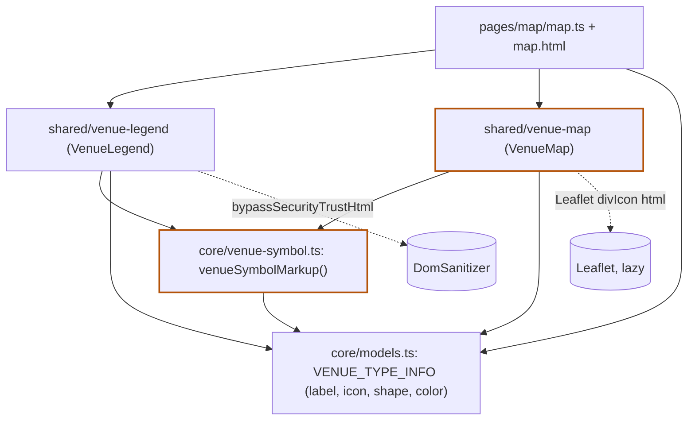

# Architektur-Analyse: SERVICE-10-STORY-02 – Ortstypen an Symbol und Farbe erkennen

**Ticket:** SERVICE-10 (Story SERVICE-10-STORY-02)  
**Analysiert:** 2026-10-29  
**Scope:** `web/src/app/core/models.ts` (VENUE_TYPE_INFO, VenueSymbolShape), `core/venue-symbol.ts` (+spec), `shared/venue-map/venue-map.ts` (Marker, Symbole, Textalternative; +spec), `shared/venue-legend/` (ts, html, css, spec), `pages/map/map.html`, `map.ts`, `map.spec.ts` (nur Legende)  
**Status:** Entwurf – wartet auf Abnahme  
**Berücksichtigte ADRs / Gherkin:** ADR-002, ADR-004, ADR-016 (alle ADRs in `docs/architecture/` gesichtet) / `web/karte.feature` (Symbol und Farbe je Typ, Legende der Ortstypen); EARS MAP-UB-10 bis MAP-UB-12; Q-USE-9

---

## 1. Executive Summary

| Kriterium | Bewertung |
|---|---|
| Gesamtarchitektur-Score | 8 / 10 |
| Architektur-Reifegrad | Hoch |
| Komponentenorientierung | Stark |
| Wartbarkeit | Hoch |
| Testbarkeit | Hoch |
| Technische Schuld | Gering |
| ADR-Konformität | vollständig konform (0 Verstöße) |

Die Story setzt ADR-016 sauber um: `VENUE_TYPE_INFO` ist die einzige Quelle für Farbe und Form, `venueSymbolMarkup` ist die einzige Zeichenfunktion, und Marker wie Legende lesen beide daraus. Die Legende ist eine kleine, präsentationale Standalone-Komponente ohne Eingaben und Services außer dem `DomSanitizer`; die Seite `map` bindet sie nur ein. Die Abhängigkeitsrichtung ist sauber (`core` kennt keine Komponenten, `shared` kennt `core`). Dass Marker und Legende nicht auseinanderlaufen können, wird zusätzlich vom Compiler (`Record<VenueType, …>`, `Record<VenueSymbolShape, …>`) und von Tests abgesichert. Es gibt keine ADR-Verstöße und keine Befunde mit hoher Priorität. Zwei niedrige Befunde betreffen die Ablage der Symbolzeichnung (`core/` statt `shared/`) und die Marker-Erzeugung, die in `VenueMap.showMarkers` mit Layer-Verwaltung und Kartenausschnitt vermischt ist.

### Überblick Architektur (Scope)

---

## 2. Analyse nach Kategorien

### Komponentenarchitektur

- **Bewertung:** Stark
- **Beobachtungen:** `VenueLegend` ist rein präsentational: keine Inputs, keine Zustände, `entries` ist eine Konstante aus `VENUE_TYPE_INFO` (`shared/venue-legend/venue-legend.ts:18-22`). Die Seite orchestriert nur (`pages/map/map.html:65-69`, `map.ts:15`). Die Legende liegt wie in ADR-016 gefordert als HTML außerhalb des Leaflet-Containers. `VenueMap` bündelt dagegen mehrere Aufgaben (Lazy-Laden, Stylesheet, Tiles, Marker, Popup, Router-Navigation, Resize), die Story ergänzt nur die Marker-Erzeugung (`venue-map/venue-map.ts:127-139`) – siehe ARCH-02.
- **Architektur-Risiko:** gering.
- **Skalierungsrisiko:** `VenueMap` wächst mit jedem Kartenmerkmal (Cluster, Auswahl, Hervorhebung), ADR-016 nennt Cluster bereits als Option.
- **Wartbarkeitsauswirkung:** gering.

### State Management & Reaktivität

- **Bewertung:** Stark
- **Beobachtungen:** Legende hat keinen Zustand. Marker folgen über `effect` dem Input `venues` und dem Signal `map` (`venue-map.ts:51-55`); der Effekt kapselt nur den Aufruf von `showMarkers`. Zoneless-tauglich, da keine Zonen-Abhängigkeit hinzukam.
- **Architektur-Risiko:** gering.
- **Skalierungsrisiko:** `showMarkers` löscht und baut bei jeder Änderung alle Marker neu (`venue-map.ts:126-139`); bei den heutigen Datenmengen unkritisch.
- **Wartbarkeitsauswirkung:** gering.

### Service-Schicht

- **Bewertung:** Stark (nicht betroffen)
- **Beobachtungen:** Die Story führt keinen Service ein. `venueSymbolMarkup` ist eine reine Funktion ohne Zustand (`core/venue-symbol.ts:17-20`), gut testbar (`venue-symbol.spec.ts`). Kein neuer Datenzugriff.
- **Architektur-Risiko:** –
- **Skalierungsrisiko:** –
- **Wartbarkeitsauswirkung:** –

### Struktur & Abhängigkeiten

- **Bewertung:** Stark
- **Beobachtungen:** Standalone-Komponente, kein NgModule (ADR-002). Keine Zyklen: `models.ts` kennt `venue-symbol.ts` nicht; `venue-symbol.ts` importiert nur `models`. Die Typ-/Modell-Ownership ist klar (`VenueSymbolShape` neben `VENUE_TYPE_INFO`). Auffällig: `core/` enthält mit `venue-symbol.ts` nun SVG-Darstellung, ADR-002 beschreibt `core/` als „Konfiguration, Datenzugriff“ und `shared/` als „Wiederverwendbares“ (ARCH-01). Die Komponente liegt dagegen korrekt unter `shared/`.
- **Architektur-Risiko:** gering.
- **Skalierungsrisiko:** Weitere Darstellungshelfer in `core/` verwischen die Schichtgrenze.
- **Wartbarkeitsauswirkung:** gering.

### Kopplung & Kohäsion

- **Bewertung:** Stark
- **Beobachtungen:** Hohe Kohäsion in `VENUE_TYPE_INFO` (ein Typ, eine Zeile) und `GLYPHS` (`venue-symbol.ts:4-11`). Kopplung zwischen `VenueMap`/`VenueLegend` läuft ausschließlich über die gemeinsame Funktion und Konstante, nicht untereinander. Die Tests sichern die Gleichheit von Marker- und Legendensymbol (`venue-legend.spec.ts:24-34`), den Kontrast (`venue-symbol.spec.ts:31-36`) und die Textalternative (`venue-map.spec.ts` „Textalternative“).
- **Architektur-Risiko:** gering. Das Symbolmarkup wird in zwei Konsumenten unterschiedlich eingehängt (Leaflet `html`, Angular `[innerHTML]` + `bypassSecurityTrustHtml`); die Vertrauensentscheidung liegt damit beim Aufrufer, nicht bei der Quelle (siehe Abschnitt 7, dokumentierte Annahme).
- **Skalierungsrisiko:** Ein dritter Konsument (z. B. Ortsliste) müsste die Vertrauensentscheidung erneut treffen.
- **Wartbarkeitsauswirkung:** gering.

---

## 3. Prinzipien

### SRP – Score 8

- **Eingehalten:** `venue-symbol.ts` zeichnet nur; `VenueLegend` zeigt nur die Legende; `VENUE_TYPE_INFO` hält nur Typ-Anzeige.
- **Verletzt:** `VenueMap` hat viele Verantwortlichkeiten (`venue-map.ts:84-166`); die Story fügt Marker-Erzeugung hinzu (ARCH-02). `models.ts` mischt Datenmodell und Darstellung (Farbe, Form), was aber schon durch das bestehende Feld `icon` vorgezeichnet war.
- **Auswirkung:** kognitive Komplexität von `VenueMap` steigt leicht.

### OCP – Score 8

- **Eingehalten:** Ein neuer Ortstyp erzwingt per `Record` einen Eintrag in `VENUE_TYPE_INFO` und, falls neue Form, einen Eintrag in `GLYPHS` (`venue-symbol.ts:4`); Marker und Legende übernehmen ihn automatisch (Iteration über `Object.keys`).
- **Verletzt:** Eine neue Form berührt zwei Dateien (`models.ts`: Union, `venue-symbol.ts`: Zeichnung); Compiler zeigt die Lücke an, daher unkritisch.
- **Auswirkung:** Erweiterbarkeit gut.

### LSP – Score 9

- **Eingehalten:** Keine Vererbung; die Story führt keine Typhierarchien ein.
- **Verletzt:** –
- **Auswirkung:** –

### ISP – Score 9

- **Eingehalten:** `venueSymbolMarkup(type)` nimmt nur den Typ, die Legende liest nur Label und Symbol.
- **Verletzt:** –
- **Auswirkung:** –

### DIP – Score 8

- **Eingehalten:** Marker und Legende hängen von der Abstraktion `VENUE_TYPE_INFO`/`venueSymbolMarkup`, nicht voneinander. `DomSanitizer` und `Router` werden per `inject()` bezogen.
- **Verletzt:** `VenueMap` hängt direkt an Leaflet-Typen (bewusst, ADR-004).
- **Auswirkung:** Testbarkeit gut; Tests laufen mit echtem Leaflet im Browser (Karma).

### Separation of Concerns – Score 8

- **Eingehalten:** Daten (`VENUE_TYPE_INFO`), Zeichnung (`venue-symbol.ts`), Darstellung (Legende, Marker), Seite (Orchestrierung) sind getrennt; Text steht außerhalb der Symbole (`aria-hidden`).
- **Verletzt:** Farbwerte und Formnamen als Darstellungsdaten stehen im Domänenmodell (`models.ts:126-133`); `showMarkers` mischt Marker, Layer und Kartenausschnitt (ARCH-02).
- **Auswirkung:** gering.

### Law of Demeter – Score 9

- **Eingehalten:** Zugriffe wie `VENUE_TYPE_INFO[type].label` sind Datenzugriffe, keine Navigationsketten durch Objekte mit Verhalten.
- **Verletzt:** `marker.getElement()?.setAttribute(...)` (`venue-map.ts:138`) greift auf das Leaflet-DOM-Element durch; vertretbar.
- **Auswirkung:** –

---

## 4. Identifizierte Architektur-Schwächen

### ARCH-01: Symbolzeichnung (SVG-Darstellung) liegt in `core/` statt in `shared/`

- **Priorität:** Niedrig
- **Betroffene Stelle:** `web/src/app/core/venue-symbol.ts:1-20`; Konsumenten `shared/venue-map/venue-map.ts:6`, `shared/venue-legend/venue-legend.ts:4`
- **Beschreibung:** ADR-002 ordnet `core/` Konfiguration und Datenzugriff zu und `shared/` Wiederverwendbares. `venue-symbol.ts` ist reine Darstellung (SVG-Markup, Farbe, Glyphen) und wird nur von zwei `shared`-Komponenten genutzt. `core/` enthält allerdings bereits fachliche Hilfsfunktionen (`exhibition-kind.ts`, `exhibition-status.ts`), die Grenze ist im Projekt nicht scharf; die Ablage ist daher kein ADR-Verstoß, sondern eine Unschärfe.
- **Verletztes Prinzip / ADR:** SoC; ADR-002 (Verzeichnisstruktur) nur dem Sinn nach
- **Konsequenz:** Wächst die Darstellung (weitere Symbole, Größen, Varianten), landet sie weiter in `core/` und `core/` wird zur Ablage für Darstellungslogik. Heute kein Schaden.
- **Langfristiges Risiko:** Gering; Verschiebung später ist billig (zwei Importpfade).

### ARCH-02: Marker-Erzeugung in `showMarkers` mit Layer-Verwaltung und Kartenausschnitt vermischt

- **Priorität:** Niedrig
- **Betroffene Stelle:** `web/src/app/shared/venue-map/venue-map.ts:122-146`, insbesondere `:128-138`
- **Beschreibung:** In einer Methode entstehen Text, `divIcon`, Marker, Textalternative (`aria-label` nachträglich per `getElement()`), Popup, Layer-Verwaltung und `fitBounds`. Die Option `alt: text` (`:136`) hat bei einem `divIcon` keine Wirkung (Leaflet setzt `alt` nur für ``-Icons, `node_modules/leaflet/src/layer/marker/Marker.js:230`); die tatsächliche Textalternative kommt allein aus dem `aria-label` in `:138`. Beides nebeneinander ist missverständlich.
- **Verletztes Prinzip / ADR:** SRP, KISS (strukturell)
- **Konsequenz:** Die Marker-Konstruktion (Text, Icon, Attribute) ist nur über eine echte Leaflet-Karte testbar (siehe Tests, die `until(markerCount…)` abwarten). Neue Marker-Merkmale (Hervorhebung, Cluster) vergrößern `showMarkers` weiter.
- **Langfristiges Risiko:** Gering bis mittel, falls Cluster oder Auswahlzustand dazukommen (ADR-016 nennt Cluster als künftige Option).

---

## 5. Skalierbarkeit & Risiken

- **Wachsende Feature-Anforderungen:** Neue Ortstypen sind billig (ein Eintrag je Konstante plus ggf. ein Glyph). Zusätzliche Zustände (aktiv, gefiltert, Cluster) würden `VenueMap` belasten.
- **Team-Wachstum:** Die Regel „Marker und Legende nur aus einer Quelle“ ist in ADR-016 und in Tests festgehalten; neue Beteiligte können sie nicht unbemerkt umgehen.
- **Zunehmende fachliche Komplexität:** Mehr Typen oder Unterarten erfordern Unterscheidbarkeit allein über Form/Farbe; fünf Formen im 32-px-Raster sind bereits dicht (fachlich/UX, nicht bewertbar ohne Nutzerdaten).

### Top 5 architektonische Risiken

1. `VenueMap` als Sammelstelle für Kartenfunktionen – ARCH-02.
2. Vertrauensentscheidung für SVG-Markup liegt bei jedem Konsumenten (siehe Abschnitt 7) – kein eigener Befund, solange es nur zwei Konsumenten gibt.
3. Darstellungslogik in `core/` – ARCH-01.
4. Komplettes Neuzeichnen aller Marker bei jeder Filteränderung – erst bei deutlich mehr Orten relevant.
5. Farbwerte im TypeScript-Modell statt in CSS-Variablen; Kontrast-Test hat Kartenhintergründe hartkodiert (`venue-symbol.spec.ts:7`) – Pflegeaufwand bei geänderter Kartenkachel-Optik.

### Alternative Ansätze (optional)

- **Präsentationale Komponente `VenueSymbol`** (Input `type`), die das SVG selbst rendert und die Vertrauensentscheidung kapselt: einheitlicher Einsatz in Legende und künftigen Listen; Trade-off: Leaflet braucht weiterhin einen String, die Funktion bleibt also bestehen. Nur bei einem dritten Konsumenten sinnvoll (YAGNI).

---

## 6. Positive Aspekte

- Eine Quelle für Marker und Legende (`VENUE_TYPE_INFO` plus `venueSymbolMarkup`), vom Compiler und von Tests abgesichert – entspricht ADR-016 genau.
- `Record<VenueType, …>` und `Record<VenueSymbolShape, …>` machen fehlende Einträge zu Übersetzungsfehlern.
- Legende als einfache Komponente ohne Zustand, außerhalb des Leaflet-Containers, mit Text neben dem Symbol und `aria-hidden` auf dem SVG.
- Reine Funktion für die Zeichnung, gut testbar; Tests prüfen Kontrast (≥ 3:1) gegen beide Kartenhintergründe und Weiß.
- Keine neuen Dateien oder Drittanbieter-Ressourcen (ADR-004).
- Popup aus DOM-Elementen statt HTML aus Daten (`venue-map.ts:149-166`).

---

## 7. Bewusst nicht gemeldet

- `bypassSecurityTrustHtml` für das konstante SVG in der Legende (`venue-legend.ts:20-21`): dokumentierte Annahme in `PIPELINE.md`; das Markup entsteht ausschließlich aus Konstanten (`GLYPHS`, `VENUE_TYPE_INFO`), kein Datenwert fließt ein. Nur als Hinweis: Kommen Datenwerte (z. B. Farbe aus JSON) je in das Markup, muss diese Entscheidung neu bewertet werden.
- Farbe und Form im Domänenmodell `models.ts`: ADR-016 legt sie ausdrücklich in `VENUE_TYPE_INFO`; das Feld `icon` stand dort bereits.
- Legende zeigt immer alle fünf Typen, auch bei gefilterter Karte (MAP-UB-11, an H1 bestätigt).
- Symbolgrößen 30 px/24 px und Marker-Mittelpunkt auf der Koordinate: dokumentierte Annahme.
- Komplettes Neuaufbauen der Marker bei Änderung von `venues`: bei dem Datenumfang unkritisch und vor der Story gleich.

---

## 8. Abgeleitete Tasks (Top-Maßnahmen)

| Task | Titel | Priorität | Aufwand | Befunde | Erwartete Wirkung |
|---|---|---|---|---|---|
| [TASK-01](TASK-01-marker-icon-aus-showmarkers-herausloesen.md) | Marker-Icon und Textalternative aus `showMarkers` herauslösen, wirkungslose `alt`-Option entfernen | Low | ~45 min | ARCH-02 | Klarere Verantwortung, eindeutige Textalternative |
| [TASK-02](TASK-02-symbolzeichnung-in-shared-ablegen.md) | Ablage der Symbolzeichnung klären (`core/` oder `shared/`) | Low | ~20 min | ARCH-01 | Schichtgrenze nach ADR-002 eindeutig |

---

## 9. Nicht bewertbar

- Visuelle Unterscheidbarkeit der fünf Formen bei 30 px und die Wahrnehmung der Farben (Farbsehschwäche): nicht per Code-Review prüfbar, gehört zu Q-USE-9 und zur Abnahme an H2 (nicht gemessen, Browser nicht gestartet).
- Verhalten des Fokusrings auf `divIcon`-Markern (Leaflet-CSS): nicht im Scope gemessen.
