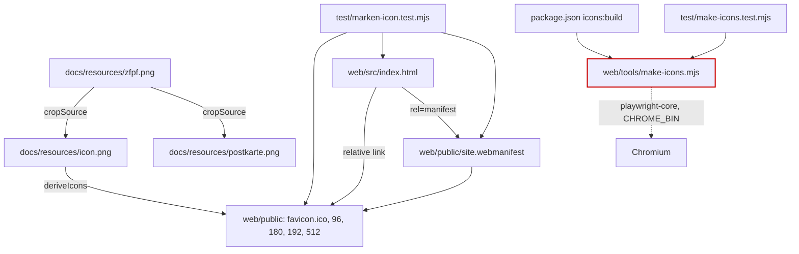

# Architektur-Analyse: SERVICE-11-STORY-01 – Icon als Anwendungs-Icon

**Ticket:** SERVICE-11 (Story SERVICE-11-STORY-01)  
**Analysiert:** 2026-10-29  
**Scope:** Dateien der Story (Branch-Diff gegen main, begrenzt): `web/tools/make-icons.mjs`, `test/make-icons.test.mjs`, `test/png-helpers.mjs`, `test/marken-icon.test.mjs` (ohne Postkarten-Tests), `web/src/index.html`, `web/public/site.webmanifest`, Icon-Dateien in `web/public/`, `docs/resources/icon.png`, `package.json` (`icons:build`), `README.md` (Abschnitt Icon und Postkartenmotiv)  
**Status:** Entwurf – wartet auf Abnahme  
**Berücksichtigte ADRs / Gherkin:** ADR-002, ADR-003, ADR-017 (alle weiteren ADRs gelesen, nicht einschlägig) / `web/markenicon.feature`, `setup/bildmaterial.feature`

---

## 1. Executive Summary

| Kriterium | Bewertung |
|---|---|
| Gesamtarchitektur-Score | 8 |
| Architektur-Reifegrad | Hoch (für den Umfang) |
| Komponentenorientierung | Nicht anwendbar (keine Angular-Komponente in dieser Story; der Kopf-Icon-Teil gehört zu STORY-02) |
| Wartbarkeit | Hoch |
| Testbarkeit | Mittel bis Hoch |
| Technische Schuld | Gering |
| ADR-Konformität | vollständig konform (0 Verstöße) |

Die Story liefert statische Assets, ein Manifest, Verknüpfungen in `index.html` und ein Hilfsskript außerhalb von `src/app/`. Es entsteht keine neue Abhängigkeit und keine Kopplung an die Anwendung: Das Skript läuft nicht im Build (ADR-017), das Manifest und alle Verweise sind relativ zum Basispfad (ADR-003). `playwright-core` ist bereits Entwicklungsabhängigkeit (`web/package.json:66`) und wird von `web/tools/quality/*` genutzt; das Skript lädt es erst bei Bedarf (`make-icons.mjs:16-18`), damit das Modul im Wurzel-Testlauf importierbar bleibt. Die Trennung in `cropSource`, `deriveIcons`, `makeAll` und `buildIco` mit überschreibbaren Pfaden macht das Skript testbar. Verifiziert: `node --test test/make-icons.test.mjs test/marken-icon.test.mjs` läuft mit Chromium grün (17 Tests, 0 übersprungen). Es bleibt ein Befund niedriger Priorität (Testabdeckung des Erfolgspfads des Skripts).

### Überblick Architektur (Scope)

Rot markiert: `deriveIcons`/`makeAll`/`buildIco` ohne Erfolgstest (ARCH-01).

---

## 2. Analyse nach Kategorien

### Komponentenarchitektur

- **Bewertung:** Nicht anwendbar
- **Beobachtungen:** Keine Komponenten in dieser Story. `index.html` bleibt ein statisches Gerüst (`web/src/index.html:9-13`).
- **Architektur-Risiko:** –
- **Skalierungsrisiko:** –
- **Wartbarkeitsauswirkung:** –

### State Management & Reaktivität

- **Bewertung:** Nicht anwendbar (kein Zustand, keine Signals).

### Service-Schicht

- **Bewertung:** Nicht anwendbar. Das Skript ist ein Werkzeug außerhalb der Anwendungsschichten.

### Struktur & Abhängigkeiten

- **Bewertung:** Stark
- **Beobachtungen:**
  - Werkzeug liegt in `web/tools/` neben `sync-data.mjs`, `postbuild.mjs` und `quality/` und nutzt dieselbe Abhängigkeit wie `web/tools/quality/browser-check.mjs:4`.
  - Quelle und Ableitungen sind getrennt: Quellmaterial in `docs/resources/`, ausgeliefert wird nur, was in `web/public/` liegt; Ergebnisdateien sind eingecheckt (ADR-017).
  - Alle Verweise in `index.html:9-13` und im Manifest (`site.webmanifest:4-5, 12, 18`) sind relativ; `start_url` und `scope` sind `.` und lösen gegen den Manifest-Pfad auf, also unter dem Basispfad (ADR-003). Der Test `marken-icon.test.mjs:61-81` sichert das ab.
  - Kleinigkeit ohne Befund: `icons:build` steht in der Wurzel-`package.json:15`, das Skript nutzt aber `web/node_modules` (Auflösung von `playwright-core` ab `web/tools/`). Die README nennt `npm install` in web/ im Fehlertext des Skripts (`make-icons.mjs:21`); das ist dokumentiert und konsistent mit anderen Wurzelskripten, die auf `web/` verweisen (`web:lint`, `web:test`).
- **Architektur-Risiko:** Gering
- **Skalierungsrisiko:** Gering; weitere Bildableitungen (z. B. Open-Graph-Bild) könnten das Muster wiederverwenden.
- **Wartbarkeitsauswirkung:** Positiv

### Kopplung & Kohäsion

- **Bewertung:** Stark
- **Beobachtungen:** Die in `page.evaluate` ausgeführten Funktionen `splitInBrowser`/`scaleInBrowser` sind selbstständig (keine Closure-Zugriffe), Node-Seite (Dateien, ICO) und Browser-Seite (Pixelarbeit) sind klar getrennt (`make-icons.mjs:26-162` vs. `165-216`). Pfade sind per Parameter überschreibbar, Tests arbeiten in temporären Ordnern. Die Tests koppeln über `png-helpers.mjs` ohne neue Abhängigkeit (`marken-icon.test.mjs:120` prüft das sogar). Testbarkeit: Zuschnitt gut abgedeckt (`make-icons.test.mjs:33-69`), Erfolgspfad der Ableitung nicht (ARCH-01).
- **Architektur-Risiko:** Gering
- **Skalierungsrisiko:** Gering
- **Wartbarkeitsauswirkung:** Hoch, bis auf ARCH-01

---

## 3. Prinzipien

### SRP – Score 8

- **Eingehalten:** Funktionen mit je einer Aufgabe (`cropSource`, `deriveIcons`, `buildIco`, `launch`); Tests pro Gherkin-Szenario.
- **Verletzt:** `splitInBrowser` (`make-icons.mjs:26-162`) vereint Motiverkennung, Zuschnitt und Freistellung (ca. 135 Zeilen). Für ein einmaliges Werkzeug vertretbar, bei Erweiterung ein Kandidat zum Aufteilen.
- **Auswirkung:** Kognitive Komplexität, kein Defekt.

### OCP – Score 7

- **Eingehalten:** Zielgrößen stehen als Liste (`make-icons.mjs:199`), Pfade sind Parameter.
- **Verletzt:** Die Dateiliste mit Größen ist doppelt vorhanden (Größenliste Zeile 199 und Dateinamen Zeilen 202-207, außerdem im Test `marken-icon.test.mjs:13-18`). Neue Größe bedeutet Änderung an mehreren Stellen.
- **Auswirkung:** Erweiterbarkeit, gering.

### LSP – Score 9

- Nicht einschlägig (keine Vererbung).

### ISP – Score 9

- Exportierte Schnittstelle schlank (`cropSource`, `deriveIcons`, `makeAll`, `buildIco`, `DEFAULTS`).

### DIP – Score 8

- **Eingehalten:** Browser und Pfade als Parameter bzw. Umgebungsvariable (`CHROME_BIN`); `playwright-core` wird lazy geladen.
- **Verletzt:** Das Skript ist an Chromium als Bildverarbeiter gebunden (bewusst, ADR-017, Alternativen dort abgewogen).
- **Auswirkung:** Ergebnis kann sich mit der Chromium-Version bei Neuerzeugung in Pixeln ändern (Binärdiff); wegen eingecheckter Ergebnisse unkritisch.

### Separation of Concerns – Score 9

- Quelle (`docs/resources`), Ableitung (Skript), Auslieferung (`web/public`), Einbindung (`index.html`, Manifest), Prüfung (`test/`) sind getrennt; Postkartenmotiv wird nicht ausgeliefert (IMG-UB-4).

### Law of Demeter – Score 9

- Keine problematischen Aufrufketten; `page.evaluate` mit serialisierten Argumenten.

---

## 4. Identifizierte Architektur-Schwächen

### ARCH-01: Erfolgspfad von `deriveIcons`/`makeAll`/`buildIco` ohne Skripttest

- **Priorität:** Niedrig
- **Betroffene Stelle:** `web/tools/make-icons.mjs:165-186` (`buildIco`), `:190-209` (`deriveIcons`), `:212-216` (`makeAll`); Tests: `test/make-icons.test.mjs:76-77` (nur Fehlerfall)
- **Beschreibung:** Die Tests belegen den Zuschnitt (`cropSource`) mit synthetischem Quellbild. Die Ableitung der Icon-Dateien wird nur über die eingecheckten Ergebnisdateien (`marken-icon.test.mjs:20-54`) geprüft, nicht über einen Lauf des Skripts. `buildIco` ist eine reine Node-Funktion, könnte also ohne Chromium getestet werden, und wird nicht direkt geprüft.
- **Verletztes Prinzip / ADR:** Testbarkeit (ADR-017 verlangt Reproduzierbarkeit und Prüfbarkeit der Ableitung; Gherkin IMG-UB-2, IMG-UB-3 im Erfolgsfall nur indirekt belegt)
- **Konsequenz:** Eine Änderung am Skript (Größen, Header, Skalierung) bleibt unbemerkt, bis jemand `icons:build` ausführt und die Ergebnisse vergleicht; die Tests prüfen weiter den alten eingecheckten Stand und bleiben grün.
- **Langfristiges Risiko:** Schleichende Abweichung zwischen Skript und eingecheckten Dateien; geringes Risiko, weil das Skript selten läuft.

Hinweis ohne Befund: In der CI läuft `npm test` im Wurzelverzeichnis ohne `CHROME_BIN`, die Browser-Tests werden dort übersprungen (`make-icons.test.mjs:14-20`). Das ist als Annahme in `PIPELINE.md` dokumentiert und wird hier nicht als Befund geführt.

---

## 5. Skalierbarkeit & Risiken

- **Wachsende Feature-Anforderungen:** Weitere Bildvarianten lassen sich in `deriveIcons` ergänzen; die Größen-/Dateiliste sollte dann zentral werden (OCP-Hinweis oben).
- **Team-Wachstum:** README-Abschnitt und Skriptkopf erklären Aufruf und Voraussetzung; Fehlermeldung bei fehlendem Chromium ist handlungsleitend (`make-icons.mjs:21`).
- **Zunehmende fachliche Komplexität:** Die Freistellung per Schwellwert (`WHITE = 244`, Flood Fill vom Rand, `make-icons.mjs:73-98`) ist an das aktuelle Quellbild angepasst; ein Quellbild mit hellen Motivflächen am Rand würde dort transparent. Nicht verifiziert für andere Bilder (Annahme), für das vorhandene Bild geprüft: Ecken transparent, Mitte deckend (`marken-icon.test.mjs:46-54`).

### Top 5 architektonische Risiken

1. Skript und eingecheckte Ergebnisse können unbemerkt auseinanderlaufen – ARCH-01 (niedrig).
2. Pixelergebnis hängt von der Chromium-Version ab (Binärdiffs bei Neuerzeugung) – kein Befund, ADR-017 abgewogen.
3. Schwellwert-Freistellung ist bildspezifisch – kein Befund, nur bei neuem Quellbild relevant.

### Alternative Ansätze (optional)

Keine; ADR-017 hat die Alternativen (`sharp`, Online-Generator, SVG, ImageMagick) bereits bewertet.

---

## 6. Positive Aspekte

- Keine neue Abhängigkeit; lazy Import von `playwright-core` hält den Wurzel-Testlauf unabhängig von `web/node_modules`.
- Pfade überschreibbar, Tests arbeiten in temporären Ordnern und verändern keine Projektdateien.
- Konsequent relative Pfade im Manifest und in `index.html`, durch Tests auch gegen den Produktionsbuild abgesichert (`marken-icon.test.mjs:101-109`).
- Größenbudgets (Q-PERF-7) und Dateigrößen automatisch geprüft.
- Klare Trennung von Quellmaterial und Auslieferung; Fehlermeldungen des Skripts sind verständlich (fehlendes Quellbild, falsche Motivzahl, fehlender Master).

---

## 7. Bewusst nicht gemeldet

- Skript läuft nicht im Build und nicht in der CI, Ergebnisse eingecheckt, Chromium als Werkzeug: ADR-017.
- `favicon.ico` mit PNG-Daten, 512 px aus 450-px-Master hochskaliert, angepasste Größenbudgets, Tests ohne `CHROME_BIN` in der CI übersprungen, CI-Zeile mit `--base-href`: dokumentierte Annahmen in `PIPELINE.md`.
- `docs/resources/` fehlt in der Ablagestruktur von `AGENTS.md`: dokumentierte Annahme und ADR-017.
- Kein Service Worker, Manifest nur für Verknüpfungen: ADR-017, Konsequenzen.
- Manifest ohne `purpose: maskable`: kein Anspruch in der Spezifikation (Annahme: Muster Klangland).
- `<base href="/">` im Quell-`index.html` (`web/src/index.html:7`) mit relativen Verweisen: Muster aus ADR-003, der Build setzt den Basispfad.

---

## 8. Abgeleitete Tasks (Top-Maßnahmen)

| Task | Titel | Priorität | Aufwand | Befunde | Erwartete Wirkung |
|---|---|---|---|---|---|
| [TASK-01](TASK-01-icon-skript-ableitung-testen.md) | Erfolgspfad der Icon-Ableitung testen und ICO-Bau einzeln prüfen | Low | ~45 min | ARCH-01 | Skriptänderungen werden von Tests erkannt |

---

## 9. Nicht bewertbar

- Wirkung des Icons im Kopfbereich und Komponentenarchitektur: Teil von STORY-02, nicht in diesem Scope.
- Verhalten der Manifest-Verknüpfung auf Endgeräten (Startbildschirm unter dem Basispfad auf GitHub Pages): nicht gemessen, nur über Dateiprüfungen belegt.
