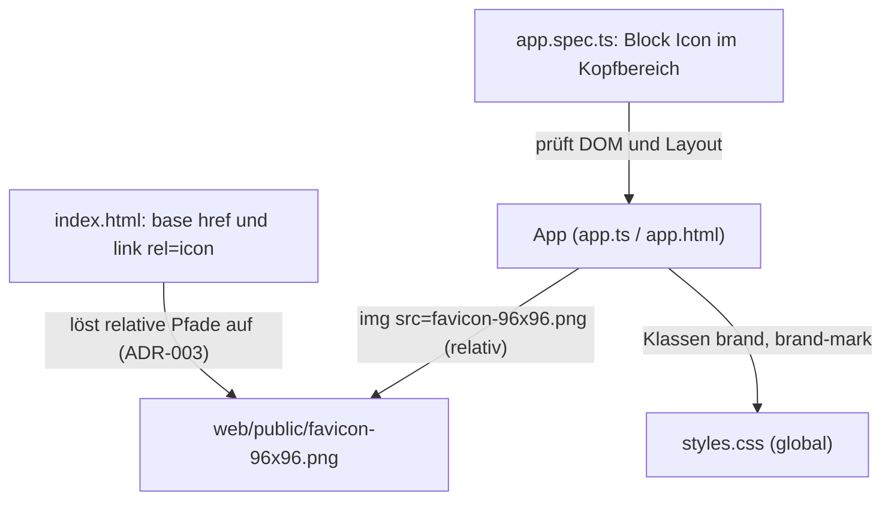

# Architektur-Analyse: Icon im Kopfbereich vor dem Namen (STORY-02)

**Ticket:** SERVICE-11 (Story SERVICE-11-STORY-02)  
**Analysiert:** 2026-10-29  
**Scope:** `web/src/app/app.html`, `web/src/styles.css` (`.brand`, `.brand-mark`), `web/src/app/app.spec.ts` (Block „Icon im Kopfbereich“); Nachbarschaft: `web/src/app/app.ts`, `web/src/app/app.css`, `web/src/index.html`, `web/angular.json`  
**Status:** Entwurf – wartet auf Abnahme  
**Berücksichtigte ADRs / Gherkin:** ADR-002, ADR-003, ADR-017 / `web/markenicon.feature` (Szenarien „Icon im Kopfbereich“, „Icon auf jeder Seite gleich“, „Pfade relativ zum Basispfad“), EARS ICO-UB-3 bis ICO-UB-6

---

## 1. Executive Summary

| Kriterium | Bewertung |
|---|---|
| Gesamtarchitektur-Score | 9 |
| Architektur-Reifegrad | Hoch |
| Komponentenorientierung | Stark |
| Wartbarkeit | Hoch |
| Testbarkeit | Hoch |
| Technische Schuld | Gering |
| ADR-Konformität | vollständig konform |

Die Änderung ist ein reiner Template- und CSS-Eingriff in der Wurzelkomponente `App`. Es entsteht keine neue Komponente, kein Service und kein neuer Zustand; das wäre für ein statisches, dekoratives `` auch überdimensioniert (KISS/YAGNI). Das Template folgt ADR-017 wörtlich (dekoratives Bild, leeres `alt`, `aria-hidden`, `width`/`height`, kein `loading="lazy"`, relativer Pfad nach ADR-003). Die Komponententests prüfen die EARS-Anforderungen ICO-UB-3 bis ICO-UB-6 beobachtbar am DOM; der Lauf von `app.spec.ts` ist grün (50 von 50). Es gibt keine ADR-Verstöße und keine Befunde mit Handlungsbedarf. Einziger Hinweis ist eine doppelte Quelle für die Bildgröße (ARCH-01, niedrig, ohne Task).

### Überblick Architektur (Scope)

---

## 2. Analyse nach Kategorien

### Komponentenarchitektur

- **Bewertung:** Stark
- **Beobachtungen:** Das Icon steht direkt im Link der Startseite (`web/src/app/app.html:3`). Die Komponente bleibt rein darstellend (`web/src/app/app.ts:11-21`: nur die Linkliste). Kein Logikanteil, keine neue Verantwortung. Eine eigene `BrandComponent` wäre spekulative Abstraktion.
- **Architektur-Risiko:** Keines.
- **Skalierungsrisiko:** Sollte die Marke an mehreren Stellen erscheinen (z. B. Fußbereich, Impressum), lohnt sich dann eine gemeinsame Darstellung; heute gibt es genau eine Verwendungsstelle.
- **Wartbarkeitsauswirkung:** Positiv, minimaler Eingriff.

### State Management & Reaktivität

- **Bewertung:** Stark (nicht betroffen)
- **Beobachtungen:** Kein Zustand, keine Signals, keine Effekte; das Bild ist statisch. Die Zoneless-Vorgabe aus ADR-002 wird nicht berührt.
- **Architektur-Risiko:** Keines.
- **Skalierungsrisiko:** Keines.
- **Wartbarkeitsauswirkung:** Neutral.

### Service-Schicht

- **Bewertung:** Nicht betroffen
- **Beobachtungen:** Kein Datenzugriff. Das Bild wird als statisches Asset aus `web/public/` ausgeliefert (`web/angular.json:19-22`, `input: public`), nicht über den `DataService`.
- **Architektur-Risiko:** Keines.
- **Skalierungsrisiko:** Keines.
- **Wartbarkeitsauswirkung:** Neutral.

### Struktur & Abhängigkeiten

- **Bewertung:** Stark
- **Beobachtungen:** Der relative Pfad `favicon-96x96.png` (`web/src/app/app.html:3`) löst über `<base href>` (`web/src/index.html:7`) auf und trägt damit ADR-003 mit; das Prerendering unter einem Basispfad bleibt funktionsfähig. Die Datei wird bewusst mit dem Favicon geteilt (ADR-017), es entsteht keine zusätzliche Auslieferung. Die Abhängigkeit zwischen Template und Dateiname ist implizit (siehe ARCH-01 und Abschnitt 7).
- **Architektur-Risiko:** Gering: Wird `favicon-96x96.png` umbenannt, bricht der Kopf still; der Komponententest (`web/src/app/app.spec.ts:~182`) und `test/marken-icon.test.mjs` würden das anzeigen.
- **Skalierungsrisiko:** Keines.
- **Wartbarkeitsauswirkung:** Gut.

### Kopplung & Kohäsion

- **Bewertung:** Stark
- **Beobachtungen:** Die Kopfzeilen-Stile (`.site-header`, `.brand`, `.brand-mark`) liegen gebündelt in `web/src/styles.css:28-34`, wie schon vor dem Ticket; `web/src/app/app.css` ist nur 211 Byte groß und enthält keine Kopfstile. Die neue Regel setzt die bestehende Konvention fort (kein neuer Bruch). Die Tests prüfen Verhalten (Reihenfolge, Zugänglichkeit, gemessene Größe) und nicht Implementierungsdetails wie Klassennamen im Ergebnis (der Selektor `.site-header a.brand` ist nur Einstieg).
- **Architektur-Risiko:** Keines.
- **Skalierungsrisiko:** Globale Klassen können bei weiterem Wachstum kollidieren; die Namen `brand`/`brand-mark` sind spezifisch genug.
- **Wartbarkeitsauswirkung:** Gut.

---

## 3. Prinzipien

### SRP – Score 9
- **Eingehalten:** `App` bleibt Rahmen mit Navigation (`web/src/app/app.ts`); `.brand-mark` hat genau eine Aufgabe (feste Größe, `web/src/styles.css:31`).
- **Verletzt:** –
- **Auswirkung:** Keine.

### OCP – Score 8
- **Eingehalten:** Erweiterung durch Hinzufügen eines Elements und einer Regel, bestehende Regeln bleiben bis auf `.brand` (Ergänzung um `inline-flex`, `align-items`, `gap`, `web/src/styles.css:29`) unverändert.
- **Verletzt:** –
- **Auswirkung:** Keine.

### LSP – Score: nicht anwendbar
Keine Vererbung oder austauschbaren Typen im Scope.

### ISP – Score: nicht anwendbar
Keine Schnittstellen im Scope.

### DIP – Score: nicht anwendbar
Keine Abhängigkeiten auf Abstraktionen/Konkretionen im Scope; das Bild ist ein statisches Asset.

### Separation of Concerns – Score 9
- **Eingehalten:** Inhalt/Zugänglichkeit im Template (`web/src/app/app.html:3`), Darstellung in CSS (`web/src/styles.css:29-31`), Verifikation in der Spec.
- **Verletzt:** Geringfügig doppelt: Größe als Attribut und in CSS (ARCH-01), das ist aber durch ADR-017 ausdrücklich so gefordert (Layoutsprung vermeiden).
- **Auswirkung:** Gering.

### Law of Demeter – Score 9
- **Eingehalten:** Keine Kettenzugriffe im Template; die Tests greifen über `brand`/`header` auf direkte Kinder zu.
- **Verletzt:** –
- **Auswirkung:** Keine.

---

## 4. Identifizierte Architektur-Schwächen

### ARCH-01: Bildgröße hat zwei Quellen (Attribut und CSS)

- **Priorität:** Niedrig
- **Betroffene Stelle:** `web/src/app/app.html:3` (`width="32" height="32"`) und `web/src/styles.css:31` (`width: 2rem; height: 2rem`)
- **Beschreibung:** Die Intrinsic-Größe steht als Attribut (32 px), die Darstellungsgröße in `rem`. Bei Standard-Schriftgröße (16 px) sind beide gleich, bei geänderter Basisschrift gewinnt CSS (2 rem) und das Seitenverhältnis bleibt quadratisch, nur der reservierte Platz der Attribute ist dann nur Fallback vor dem Laden des CSS.
- **Verletztes Prinzip / ADR:** Kein Verstoß; ADR-017 verlangt beides ausdrücklich („Darstellungsgröße legt CSS fest, Breite und Höhe stehen als Attribute“) und die PIPELINE nennt die Größe als Annahme. Nur als Hinweis geführt.
- **Konsequenz:** Keine praktische; weil das Bild quadratisch ist und CSS immer greift, entsteht kein Layoutsprung.
- **Langfristiges Risiko:** Gering. Wird die Größe künftig geändert, müssen zwei Stellen und der Test (`web/src/app/app.spec.ts:~183`) angepasst werden.

Kein Task: Aufwand und Nutzen einer Änderung stehen in keinem Verhältnis, und die Doppelung ist spezifiziert.

---

## 5. Skalierbarkeit & Risiken

- **Wachsende Feature-Anforderungen:** Zusätzliche Marken-Bausteine (z. B. Untertitel, Dunkelmodus-Variante) ließen sich in `.brand` ergänzen; erst bei mehreren Verwendungsstellen wäre eine eigene Komponente sinnvoll.
- **Team-Wachstum:** Kopf-Stile liegen global in `styles.css`; bei mehreren Beteiligten ist eine Verlagerung in `app.css` denkbar. Das betrifft aber den Bestand, nicht diese Story.
- **Zunehmende fachliche Komplexität:** Nicht betroffen.

### Top 5 architektonische Risiken

1. Stiller Bruch des Kopf-Icons bei Umbenennung von `favicon-96x96.png` – Test fängt es ab, kein Handlungsbedarf (Bezug ARCH-01 nur mittelbar).

### Alternative Ansätze (optional)

Nicht erforderlich.

---

## 6. Positive Aspekte

- Minimaler, ADR-treuer Eingriff ohne neue Abstraktion (`web/src/app/app.html:3`).
- Zugänglichkeit sauber: `alt=""`, `aria-hidden="true"`, Linkname bleibt Text (`web/src/app/app.html:3`; Test `web/src/app/app.spec.ts` „das Icon ist dekorativ“).
- Layoutstabilität: `flex: none` und feste Größe verhindern Schrumpfen und Sprünge (`web/src/styles.css:31`); das Layout verträgt den Umbruch der Navigation (Test misst die Kopfhöhe mit/ohne Icon).
- Tests sind je Szenario mit EARS-ID benannt und im Dateikopf auf das Gherkin-Feature verwiesen (Rückverfolgbarkeit).
- Szenario „Icon auf jeder Seite gleich“ setzt das Testmodul je Seite zurück und prüft fünf Routen (`web/src/app/app.spec.ts`, letzter Test).

---

## 7. Bewusst nicht gemeldet

- **Kein Einsatz von `NgOptimizedImage`/`ngSrc`:** Das Bild ist ein kleines statisches Asset mit festen Maßen; ADR-017 legt `` fest. Die anderen `` der Anwendung (`web/src/app/pages/photographer-list/photographer-list.html:7`, `.../photographer-detail/photographer-detail.html:15`) sind von der Story nicht betroffen.
- **Kopf-Stile in globalem `styles.css` statt in `app.css`:** Bestehende Konvention vor dem Ticket (`web/src/styles.css:28`), nicht von dieser Story eingeführt.
- **Keine eigene Komponente für die Marke:** Eine Verwendungsstelle; YAGNI (ADR-002 verlangt Standalone-Komponenten, aber keine Zerlegung bis auf Elementebene).
- **Doppelter Dateiname `favicon-96x96.png` in Template und `index.html`:** Von ADR-017 so vorgesehen („Quelle `favicon-96x96.png`“, PIPELINE-Annahme).
- **Test greift auf `style.display` zu und misst Layout:** Dient der Prüfung von ICO-UB-6; Änderungen werden zurückgesetzt, das Verhalten ist beobachtbar. Detailqualität der Tests gehört zu `/review-code`.

---

## 8. Abgeleitete Tasks (Top-Maßnahmen)

Keine. Die einzige Beobachtung (ARCH-01) ist niedrig, spezifiziert und rechtfertigt keinen Task.

---

## 9. Nicht bewertbar

- Das visuelle Ergebnis auf 390 px und 1280 px (Sichtprüfung laut Task) wurde nicht neu gemessen; bewertet wurde nur der Code und der grüne Komponententest-Lauf (`ng test --include=src/app/app.spec.ts`, 50 von 50 erfolgreich).
- Das Verhalten des Produktionsbuilds unter einem Basispfad (Szenario „Pfade relativ zum Basispfad“, `/pf/`) liegt außerhalb dieser Dateien (`test/marken-icon.test.mjs`) und wurde nicht geprüft.
