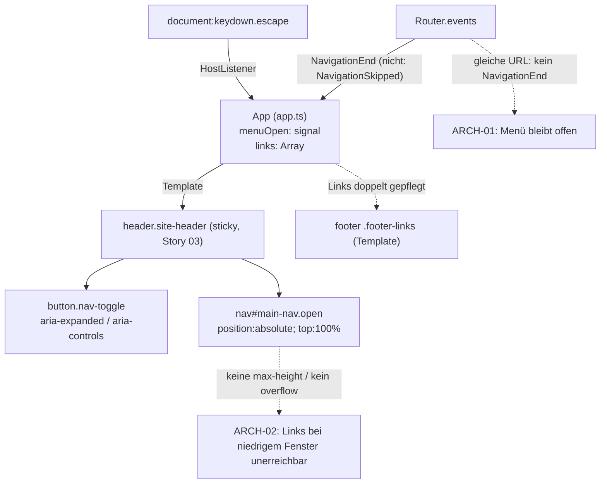

# Architektur-Analyse: SERVICE-12-STORY-01 Navigation als Burger-Menü

**Ticket:** SERVICE-12  
**Analysiert:** 2026-10-29  
**Scope:** Branch-Diff gegen main plus nicht committete Änderungen, beschränkt auf STORY-01: `web/src/app/app.ts`, `web/src/app/app.html` (Kopf: Menü-Schaltfläche, `nav#main-nav`), `web/src/styles.css` (`.nav-toggle*`, `.main-nav*`), `web/src/app/app.spec.ts` (Szenario „Kopf- und Fußbereich (FRM)“, Menü). Übrige Stories nur Kontext.  
**Status:** Entwurf – wartet auf Abnahme  
**Berücksichtigte ADRs / Gherkin:** ADR-002, ADR-003, ADR-004, ADR-016, ADR-017 / `web/seitenrahmen.feature`, `web/navigation.feature`, `web/markenicon.feature`

---

## 1. Executive Summary

| Kriterium | Bewertung |
|---|---|
| Gesamtarchitektur-Score | 7 |
| Architektur-Reifegrad | Mittel |
| Komponentenorientierung | Mittel |
| Wartbarkeit | Hoch |
| Testbarkeit | Hoch |
| Technische Schuld | Gering |
| ADR-Konformität | vollständig konform (0 Verstöße) |

Die Story ist schlank und ADR-konform umgesetzt: Der Menüzustand ist ein einzelnes Signal in `App` (ADR-002: Signals, zoneless), das Öffnen und Schließen ist ein reines Umschalten einer CSS-Klasse ohne Skript-Layout (Q-PERF-8), und die Links stehen weiterhin im vorab gerenderten HTML (ADR-002, Prerendering). Es gibt keine neue Abhängigkeit und keine neue Schicht. Zwei Befunde mittlerer Priorität betreffen Robustheit gegenüber der Spezifikation und der Skalierung: Die Wahl des Links der aktuellen Seite schließt das Menü nicht (FRM-EV-2), weil das Schließen nur an `NavigationEnd` hängt; und das absolut positionierte Menüfeld ist in der Höhe unbegrenzt und nicht scrollbar, sodass bei niedrigen Fenstern (Querformat am Telefon) untere Links unerreichbar werden. Zwei niedrige Befunde betreffen die doppelte Pflege der Linkdaten (Kopf im Skript, Fuß im Template) und die Stilkonvention (`@HostListener`).

### Überblick Architektur (Scope)

---

## 2. Analyse nach Kategorien

### Komponentenarchitektur

- **Bewertung:** Mittel
- **Beobachtungen:** `App` vereint Rahmen, Menüzustand, Tastaturbehandlung und Linkdaten (`web/src/app/app.ts:11-46`). Bei dieser Größe (ca. 45 Zeilen) vertretbar. Die Menü-Schaltfläche und das Feld sind Teil von `app.html` (Zeilen 3-26) statt einer eigenen präsentationalen Komponente.
- **Architektur-Risiko:** Gering; wächst, wenn Suche oder Filter in den Kopf kommen (Annahme in PIPELINE: nicht Teil des Wunsches).
- **Skalierungsrisiko:** Weitere Kopf-Funktionen würden `App` überladen; dann Kopf als `shared`-Komponente extrahieren (ADR-002: Wiederverwendbares unter `shared/`).
- **Wartbarkeitsauswirkung:** Gering.

### State Management & Reaktivität

- **Bewertung:** Stark mit einer Lücke
- **Beobachtungen:** Einzelne Zustandsquelle `menuOpen = signal(false)` (`app.ts:17`), Aktualisierung über `update`/`set`, kein `effect`. Die Router-Subscription ist über `takeUntilDestroyed()` an den Lebenszyklus gebunden (`app.ts:21`). Lücke: Es wird nur `NavigationEnd` ausgewertet. Bei Wahl des Links der aktuellen Adresse überspringt der Router (Standard `onSameUrlNavigation: 'ignore'`, nicht überschrieben in `app.config.ts`) die Navigation und sendet `NavigationSkipped` statt `NavigationEnd` (ARCH-01).
- **Architektur-Risiko:** Mittel, siehe ARCH-01.
- **Skalierungsrisiko:** Weitere Schließgründe (Außenklick, Fokus verlässt das Menü) wären jeweils neue Router-/DOM-Abonnements in `App`.
- **Wartbarkeitsauswirkung:** Gering.

### Service-Schicht

- **Bewertung:** Nicht betroffen
- **Beobachtungen:** Kein Datenzugriff, kein Service in der Story; `Router` über `inject()` (`app.ts:12`), konsistent.
- **Architektur-Risiko:** –
- **Skalierungsrisiko:** –
- **Wartbarkeitsauswirkung:** –

### Struktur & Abhängigkeiten

- **Bewertung:** Stark
- **Beobachtungen:** Standalone-Komponente, keine Zyklen, keine neuen Abhängigkeiten (ADR-002). Der Menüinhalt steht im vorab gerenderten HTML, `display: none` kommt aus CSS (`styles.css:46-47`), nicht aus `@if` (SSR-Lesbarkeit ohne Skript bleibt). Die Linkdaten liegen im Skript des Kopfs, die Linkdaten des Fußbereichs hartkodiert im Template (`app.html:36-41`) – zwei Muster für dieselbe Art Daten (ARCH-03). Das Menüfeld `.main-nav` benötigt einen positionierten Vorfahren (`.site-header { position: sticky }`, Story 03) – eine implizite Kopplung zwischen zwei Stories, die im CSS nicht vermerkt ist (`styles.css:46`; ARCH-04).
- **Architektur-Risiko:** Gering.
- **Skalierungsrisiko:** Weitere Bereiche erweitern `links` und verlängern das Menüfeld (ARCH-02).
- **Wartbarkeitsauswirkung:** Gering.

### Kopplung & Kohäsion

- **Bewertung:** Mittel bis Stark
- **Beobachtungen:** Die Tests (`app.spec.ts`, Szenario FRM) prüfen berechnete Stile und Geometrie gegen das globale `styles.css`; das ist sinnvoll, weil das Verhalten in CSS liegt, koppelt aber die Komponententests an die globale Datei (`styles.css` wird über `angular.json` geladen – Annahme, nicht geprüft). Menüregeln liegen in der globalen `styles.css:39-51` statt in `app.css` (211 Byte); das entspricht der bisherigen Konvention (Kopf und Fuß standen schon dort), die Komponenten-CSS ist praktisch leer.
- **Architektur-Risiko:** Gering.
- **Skalierungsrisiko:** Die globale Datei wächst mit jedem Rahmenelement; keine Kapselung für `.main-nav`, `.nav-toggle`.
- **Wartbarkeitsauswirkung:** Gering.

---

## 3. Prinzipien

### SRP – Score 7
- **Eingehalten:** Jede Methode hat eine Aufgabe (`toggleMenu`, `onEscape`).
- **Verletzt:** `App` bündelt Rahmen, Menülogik und Navigationsdaten (`app.ts:11-46`), noch tragbar.
- **Auswirkung:** Gering heute; Erweiterbarkeit des Kopfs begrenzt.

### OCP – Score 7
- **Eingehalten:** Neue Bereiche entstehen durch einen Eintrag in `links` (`app.ts:36`).
- **Verletzt:** Der Fußbereich muss separat im Template erweitert werden (`app.html:36-41`).
- **Auswirkung:** Doppelte Pflege (ARCH-03).

### LSP – Score 9
- Nicht relevant (keine Vererbung, keine Abstraktionen).

### ISP – Score 9
- Nicht relevant; keine breiten Schnittstellen.

### DIP – Score 8
- **Eingehalten:** Abhängigkeit nur von `Router` per `inject()`; kein direkter Zugriff auf `window`/`document` im Code (Escape über Framework-Binding).
- **Verletzt:** `nativeElement.focus()` (`app.ts:33`) greift direkt auf das DOM zu; im Browser-Event sicher (kein SSR-Pfad).
- **Auswirkung:** Gering.

### Separation of Concerns – Score 8
- **Eingehalten:** Zustand im Signal, Darstellung rein in CSS (`.open`), Zugänglichkeit über Attribute im Template.
- **Verletzt:** Schließlogik verteilt auf Router-Abonnement, Tastatur-Binding und Klick-Handler (`app.ts:21,25,29`) ohne gemeinsame „Schließen“-Methode.
- **Auswirkung:** Lücke ARCH-01 entsteht an dieser Verteilung.

### Law of Demeter – Score 9
- **Eingehalten:** Einzige Kette `this.menuButton()?.nativeElement.focus()` (`app.ts:33`), unkritisch.

---

## 4. Identifizierte Architektur-Schwächen

### ARCH-01: Menü schließt nicht, wenn der Link der aktuellen Seite gewählt wird

- **Priorität:** Mittel
- **Betroffene Stelle:** `web/src/app/app.ts:21`, `web/src/app/app.html:16`
- **Beschreibung:** Das Schließen hängt ausschließlich an `NavigationEnd`. Wählen Besucher:innen im geöffneten Menü den Link der Seite, auf der sie sich schon befinden (z. B. „Karte“ auf `/map`, „Magazin“ auf `/`), wird die Navigation vom Router übersprungen (Standard `ignore`); es entsteht kein `NavigationEnd`. Das Menü bleibt offen und verdeckt den Inhalt. Dies ist eine Annahme aus dem bekannten Router-Verhalten; im Code wurde `onSameUrlNavigation` nicht überschrieben (`app.config.ts`), und der Test deckt nur den Wechsel auf eine andere Adresse ab (`app.spec.ts`, „Menü schließt nach der Auswahl“, Wechsel zu `/calendar`).
- **Verletztes Prinzip / ADR:** FRM-EV-2 („Wenn Besucher:innen einen Link im Menü wählen, … das Menü schließen“), Separation of Concerns (Schließgrund an Router-Ereignis statt an Benutzeraktion)
- **Konsequenz:** Sichtbarer Fehlbedienungsfall: Klick auf den aktiven Link scheint wirkungslos, das Menü bleibt über dem Inhalt. Zusätzlich verliert der Fokus nach dem Schließen das Ziel (versteckter Link war fokussiert, Fokus fällt auf `body`), ein Hindernis für Tastaturnutzer:innen.
- **Langfristiges Risiko:** Jede weitere Schließart verstärkt die Verteilung der Logik.

### ARCH-02: Menüfeld ohne Höhenbegrenzung und ohne Scrollen

- **Priorität:** Mittel
- **Betroffene Stelle:** `web/src/styles.css:46` (`.main-nav`), `:48-49` (Höhe der Einträge)
- **Beschreibung:** Das Feld ist `position: absolute; top: 100%` innerhalb des haftenden Kopfs (Story 03) ohne `max-height` und ohne `overflow-y`. Neun Einträge mit je etwa 2,7 rem (Padding 0,6 rem je Seite, Zeilenhöhe, Abstand 0,25 rem) ergeben rund 24 bis 27 rem plus Kopfhöhe (rechnerische Annahme, nicht im Browser gemessen). Bei Fensterhöhen unter rund 30 rem (Telefon im Querformat, 320 × 640 gedreht, stark gezoomte Seite) ragt das Feld über den Rand. Da der Kopf haftet, scrollt die Seite das Feld nicht mit, die unteren Links sind weder sichtbar noch erreichbar. Q-USE-12 deckt „320 bis 1280 Pixel Breite“ ab, nicht die Höhe; das Szenario fehlt in Gherkin und Test.
- **Verletztes Prinzip / ADR:** FRM-UB-1/FRM-EV-1 (alle Bereiche erreichbar, Story-Kriterium 7), WCAG 1.4.10 Reflow/Zoom (Annahme), Skalierbarkeit
- **Konsequenz:** Bereiche „Festivals“ und „Veranstalter:innen“ nicht erreichbar im Querformat oder bei 200 % Zoom.
- **Langfristiges Risiko:** Jeder zusätzliche Bereich verschärft das Problem.

### ARCH-03: Linkdaten von Kopf und Fuß in zwei Mustern gepflegt

- **Priorität:** Niedrig
- **Betroffene Stelle:** `web/src/app/app.ts:36-46`, `web/src/app/app.html:36-41`, `web/src/app/app.routes.ts`
- **Beschreibung:** Die Kopf-Links sind ein Array im Skript (`path`, `label`, `exact`), die Fuß-Links vier hartkodierte `<a>` im Template (ebenso zusammen mit den Routen in `app.routes.ts` und `prerender`-Konfiguration). Die Menüeinträge sind von den Routen entkoppelt; ein neuer Bereich muss an mehreren Stellen eingetragen werden.
- **Verletztes Prinzip / ADR:** OCP, DRY (nur strukturell); kein ADR betroffen
- **Konsequenz:** Doppelpflege, Risiko, dass Menü, Fußbereich und Seiten auseinanderlaufen (die Tests prüfen die Beschriftungen, nicht die Quelle).
- **Langfristiges Risiko:** Gering bei neun Bereichen; steigt mit weiteren Bereichen und weiteren Rahmenelementen.

### ARCH-04: Stilbrüche und implizite Kopplungen im Rahmen

- **Priorität:** Niedrig
- **Betroffene Stelle:** `web/src/app/app.ts:29` (`@HostListener`), `web/src/styles.css:46`
- **Beschreibung:** (a) `@HostListener` ist das einzige Vorkommen im Projekt (Suche in `web/src/app`, ohne Tests) und weicht vom aktuellen Angular-Stilleitfaden (`host`-Metadaten) ab; keine ADR-Vorgabe. (b) `.main-nav` setzt `position: absolute; top: 100%` voraus, dass `.site-header` ein positionierter Vorfahre ist; diese Abhängigkeit zwischen STORY-01 und STORY-03 ist nirgends vermerkt. Fällt `position: sticky` später weg (z. B. durch Rücklauf aus Story 03), liegt das Menü am falschen Ort.
- **Verletztes Prinzip / ADR:** Konsistenz; kein ADR betroffen
- **Konsequenz:** Gering; vermeidbare Überraschung bei späteren Änderungen am Kopf.
- **Langfristiges Risiko:** Gering. Kein eigener Task; zusammen mit TASK-03 (Kommentar im CSS) bzw. bei nächster Änderung an `app.ts` mitnehmen.

---

## 5. Skalierbarkeit & Risiken

- **Wachsende Feature-Anforderungen:** Weitere Bereiche verlängern das Menüfeld (ARCH-02); weitere Kopf-Bedienelemente überladen `App` (Kopf als `shared`-Komponente, siehe Komponentenarchitektur).
- **Team-Wachstum:** Zwei Orte für Navigationsdaten und globales CSS erhöhen die Abstimmung (ARCH-03, ARCH-04).
- **Zunehmende fachliche Komplexität:** Mehr Schließgründe (Außenklick, Fokusverlust, Wechsel der Fensterbreite) benötigen eine zentrale Schließmethode (ARCH-01).

### Top 5 architektonische Risiken

1. Menü bleibt bei Wahl des aktiven Links offen – ARCH-01
2. Untere Links bei niedrigen Fenstern unerreichbar – ARCH-02
3. Doppelte Pflege der Linkdaten – ARCH-03
4. Implizite Kopplung Menüfeld/haftender Kopf – ARCH-04
5. Wachstum von `App` als Sammelkomponente – ARCH-03/ARCH-04

### Alternative Ansätze (optional)

Für ARCH-02 zwei Optionen: (a) `max-height: calc(100dvh - Kopfhöhe)` mit `overflow-y: auto` am Feld (rein CSS, kein Skript, passt zu Q-PERF-8); (b) Feld in zwei Spalten ab ausreichender Breite (mehr Gestaltungsaufwand, löst die Höhe nur teilweise). Empfehlung: (a).

---

## 6. Positive Aspekte

- Ein Signal als einzige Zustandsquelle, kein `effect`, Abonnement an den Lebenszyklus gebunden (ADR-002).
- Menü per CSS-Klasse, `display: none` im geschlossenen Zustand: Tab- und Screenreader-Unerreichbarkeit ohne Skript, Links im vorab gerenderten HTML (ADR-002, Q-PERF-8, Q-SEO).
- Zugängliche Schaltfläche: `button`, `aria-expanded`, `aria-controls`, Namen je Zustand, Escape setzt den Fokus zurück (Q-USE-12).
- Icon der Schaltfläche in reinem CSS ohne Bildbibliothek oder zusätzliche Datei.
- Tests treffen die Szenarien des Gherkin-Vertrags eins zu eins und prüfen echte berechnete Stile.

---

## 7. Bewusst nicht gemeldet

- Burger-Menü in allen Fensterbreiten, Feld in voller Breite, kein Skript-Layout: bestätigte Annahme und FRM-UB-1.
- Globale Stile statt Komponenten-CSS für Kopf und Fuß: bestehende Konvention, ADR-002 schreibt nur ein Budget für Komponenten-CSS vor.
- Kein ADR zu Sticky-Kopf und Burger-Menü: in `PIPELINE.md` begründet („ADR nicht erforderlich“).
- `ViewportScroller.setOffset([0, 96])` in `app.config.ts` und `scroll-padding-top: 6rem`: als `ANNAHME (Umsetzung)` dokumentiert und Story 03 zugehörig.
- Fehlende Prüfung im geöffneten Zustand durch axe und Playwright: im Changelog der Story als „Nicht geprüft“ ausgewiesen.
- Kein `ChangeDetectionStrategy.OnPush` an `App`: zoneless mit Signals (ADR-002), kein ADR zu OnPush.
- Ein Menü pro Seite ohne Fokusfalle: kein Dialog, Escape und Schaltfläche genügen laut Spezifikation.

---

## 8. Abgeleitete Tasks (Top-Maßnahmen)

| Task | Titel | Priorität | Aufwand | Befunde | Erwartete Wirkung |
|---|---|---|---|---|---|
| [TASK-01](TASK-01-menue-schliesst-bei-aktivem-link.md) | Menü schließt auch bei Wahl des Links der aktuellen Seite | Medium | ~45 min | ARCH-01 | FRM-EV-2 gilt in allen Fällen; zentrale Schließmethode |
| [TASK-02](TASK-02-menuefeld-scrollbar-bei-niedriger-hoehe.md) | Menüfeld an die Fensterhöhe binden und scrollbar machen | Medium | ~45 min | ARCH-02 | Alle Bereiche bei niedrigen Fenstern erreichbar |
| [TASK-03](TASK-03-navigationsdaten-zentral-pflegen.md) | Navigationsdaten für Kopf und Fuß zentral pflegen | Low | ~1 h | ARCH-03, ARCH-04 | Eine Quelle für Links; Kopplung im CSS vermerkt |

---

## 9. Nicht bewertbar

- Tatsächliche Höhe des Menüfelds im Browser (rechnerisch geschätzt, keine Messung; Review ohne Build und Test).
- Verhalten von `routerLink` auf die aktuelle Adresse in Angular 20.3 (aus bekanntem Router-Verhalten abgeleitet, nicht ausgeführt).
- Ob `styles.css` im Karma-Lauf geladen wird (die Tests setzen es voraus und sind laut Changelog grün).
- Die Auswirkung auf Screenreader im geöffneten Zustand (kein axe-Lauf im offenen Zustand, siehe Changelog).
