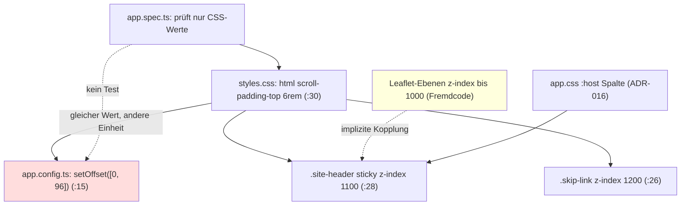

# Architektur-Analyse: SERVICE-12-STORY-03 Kopfbereich im Vordergrund

**Ticket:** SERVICE-12  
**Analysiert:** 2026-10-29  
**Scope:** Story 03: `web/src/styles.css` (`.site-header`, `html`, `.skip-link`), `web/src/app/app.config.ts` (`ViewportScroller.setOffset`), `web/src/app/app.spec.ts` (FRM-UB-2, FRM-UB-5); Basis `git diff HEAD -- web`. Übriger Code (Burger-Menü, Fußbereich) nur Kontext.  
**Status:** Entwurf – wartet auf Abnahme  
**Berücksichtigte ADRs / Gherkin:** ADR-002, ADR-003, ADR-004, ADR-016, ADR-017 / `web/seitenrahmen.feature`, `web/markenicon.feature`, `web/navigation.feature`

---

## 1. Executive Summary

| Kriterium | Bewertung |
|---|---|
| Gesamtarchitektur-Score | 8 |
| Architektur-Reifegrad | Hoch |
| Komponentenorientierung | Mittel (Seitenrahmen bewusst global gestylt) |
| Wartbarkeit | Mittel bis Hoch |
| Testbarkeit | Mittel |
| Technische Schuld | Gering |
| ADR-Konformität | vollständig konform |

Die Änderung ist klein, rein CSS-basiert und fügt sich in die bestehende Spaltenarchitektur (ADR-016) ein: `position: sticky` statt `fixed` lässt den Kopf im Seitenfluss, die Spalte `:host` (`web/src/app/app.css:2`) bleibt unberührt. Es gibt keine Skript-Layoutmessung (Q-PERF-8) und kein neues Paket (ADR-002 bleibt: Menü und Kopf stehen im vorab gerenderten HTML). Die einzige strukturelle Schwäche ist ein Wert, der an zwei Stellen in zwei Einheiten gepflegt wird (`6rem` im CSS, `96` px in TypeScript), dazu eine implizite Kopplung der Stapelreihenfolge an die Leaflet-Ebenen. Beides ist von der Spezifikation und dem Changelog bewusst benannt (PIPELINE-Annahme „bei geänderter Kopfhöhe beides anpassen“); es ist eine Drift-Gefahr, kein Fehler. Keine ADR-Verstöße, kein ADR-Bedarf.

### Überblick Architektur (Scope)

---

## 2. Analyse nach Kategorien

### Komponentenarchitektur

- **Bewertung:** Mittel
- **Beobachtungen:** Der Rahmen (`App`, `web/src/app/app.html`) ist eine schlanke Komponente; Kopf-/Fußstil liegt global in `web/src/styles.css:28-60`, nur die Spalte in `app.css:2`. Die Rahmenstile verteilen sich damit auf zwei Dateien (ARCH-04). Das Muster stammt aus vor SERVICE-12 und ist unverändert.
- **Architektur-Risiko:** Gering.
- **Skalierungsrisiko:** Weitere Rahmenelemente erhöhen die Streuung.
- **Wartbarkeitsauswirkung:** Gering.

### State Management & Reaktivität

- **Bewertung:** Stark
- **Beobachtungen:** Story 03 führt keinen Zustand ein; Verhalten per CSS. Kein `effect`, keine Subscription. `provideAppInitializer` (`app.config.ts:15`) ist ein einmaliger Konfigurations-Seiteneffekt ohne Lebenszyklusproblem; auf dem Server ist `ViewportScroller` ein Null-Scroller (Annahme, aus Angular-Verhalten, nicht im Build geprüft).
- **Architektur-Risiko:** Keines.
- **Skalierungsrisiko:** Keines.
- **Wartbarkeitsauswirkung:** Positiv.

### Service-Schicht

- **Bewertung:** Nicht betroffen. Es entsteht kein Service; `ViewportScroller` wird über `inject()` im Initializer genutzt (ADR-010-Muster funktional, hier nicht einschlägig).

### Struktur & Abhängigkeiten

- **Bewertung:** Mittel bis Stark
- **Beobachtungen:** Die Offset-Konfiguration liegt an der richtigen Stelle (Routerkonfiguration neben `withInMemoryScrolling`, `app.config.ts:13-15`). Die Abhängigkeit zwischen `styles.css:30` und `app.config.ts:15` ist nur durch einen Kommentar gesichert (ARCH-01). Die Kopplung an Leaflet-Z-Indizes steht nur im CSS-Kommentar `styles.css:29` (ARCH-02).
- **Architektur-Risiko:** Niedrig.
- **Skalierungsrisiko:** Jedes weitere Fremd-Overlay (z. B. Dialog, Toast) braucht eine Zahl in einer ungeschriebenen Ordnung.
- **Wartbarkeitsauswirkung:** Gering.

### Kopplung & Kohäsion

- **Bewertung:** Mittel
- **Beobachtungen:** Kopfhöhe (Q-USE-13: ≤ 5 rem/6 rem), `scroll-padding-top` und `setOffset` bilden eine verdeckte Triade. Tests decken das CSS (`app.spec.ts:301-306`), aber nicht den TypeScript-Anteil.
- **Architektur-Risiko:** Niedrig bis mittel (stille Regression bei Höhenänderung).
- **Skalierungsrisiko:** Gering.
- **Wartbarkeitsauswirkung:** Mittel.

---

## 3. Prinzipien

### SRP – Score 8
- **Eingehalten:** Sticky-Verhalten rein im CSS, Offset-Anpassung getrennt in der Konfiguration.
- **Verletzt:** Der Rahmen ist über `app.css` und `styles.css` verteilt (ARCH-04).
- **Auswirkung:** Auffindbarkeit.

### OCP – Score 7
- **Eingehalten:** z-Index-Ebenen lassen sich nach oben erweitern.
- **Verletzt:** Neue Overlays erfordern Kenntnis der Zahlen 1000/1100/1200 (ARCH-02).
- **Auswirkung:** Erweiterbarkeit.

### LSP – Score –
Nicht anwendbar (keine Vererbung/Schnittstellen im Scope).

### ISP – Score –
Nicht anwendbar.

### DIP – Score 8
- **Eingehalten:** `ViewportScroller` als abstrakte Angular-Schnittstelle, keine direkte `window`-Nutzung, SSR-tauglich.
- **Verletzt:** Nichts.
- **Auswirkung:** Testbarkeit gut möglich (siehe TASK-03).

### Separation of Concerns – Score 7
- **Eingehalten:** Darstellung in CSS, Router-Verhalten in der Konfiguration, kein Layout-Code in Komponenten.
- **Verletzt:** Der Wert 6 rem ist eine Darstellungsgröße, die in der Routerkonfiguration dupliziert ist (ARCH-01).
- **Auswirkung:** Kopplung, Drift.

### Law of Demeter – Score 9
Keine Verletzungen im Scope.

---

## 4. Identifizierte Architektur-Schwächen

### ARCH-01: Kopfversatz an zwei Stellen und in zwei Einheiten gepflegt

- **Priorität:** Mittel
- **Betroffene Stelle:** `web/src/styles.css:30` (`scroll-padding-top: 6rem`), `web/src/app/app.config.ts:15` (`setOffset([0, 96])`)
- **Beschreibung:** Derselbe Versatz steht einmal in `rem`, einmal in festen Pixeln. Die Verbindung besteht nur aus einem Kommentar. Ändert der Benutzer die Basisschriftgröße des Browsers (Q-USE-Anforderungen zu Skalierung), wächst `6rem`, der Router-Versatz bleibt bei 96 px: Anker-Sprünge des Routers (`anchorScrolling`, z. B. „Zum Inhalt springen“) liegen dann nicht mehr bündig, bei großer Schrift kann Inhalt unter dem Kopf beginnen. Dazu hat der Pixelanteil keinen automatisierten Test (Changelog: „Nicht geprüft“), obwohl FRM-UB-5 für die Router-Anker gilt.
- **Verletztes Prinzip / ADR:** Single Source of Truth, Separation of Concerns; kein ADR-Verstoß.
- **Konsequenz:** Bei geänderter Kopfhöhe, Schriftgröße oder Zielwert (Q-USE-13) driftet eine der Stellen unbemerkt.
- **Langfristiges Risiko:** Stille Regression von FRM-UB-5 nur im Router-Pfad; der CSS-Test bleibt grün.

### ARCH-02: Stapelreihenfolge hängt an Leaflet-Zahlen ohne Isolation

- **Priorität:** Niedrig
- **Betroffene Stelle:** `web/src/styles.css:26,28,29`
- **Beschreibung:** `z-index: 1100`/`1200` sind „größer als Leaflet 1000“ (Kommentar). Der Wert gilt nur, solange Leaflet-Ebenen im selben Stapelkontext wie der Kopf liegen und kein weiteres Overlay hinzukommt. `main` bildet keinen eigenen Stapelkontext (`isolation`), obwohl die Aufgabe in TASK-01 diese Option nannte.
- **Verletztes Prinzip / ADR:** OCP/Kopplung; ADR-004 (Leaflet) nicht verletzt.
- **Konsequenz:** Ein Leaflet-Update oder ein neues Overlay mit hohem z-Index kann den Kopf überdecken; `/map` wäre zuerst betroffen (Q-USE-13).
- **Langfristiges Risiko:** Schleichende Zahleninflation.

### ARCH-03: Router-Anker-Versatz ohne automatisierten Test

- **Priorität:** Niedrig
- **Betroffene Stelle:** `web/src/app/app.config.ts:15`, `web/src/app/app.spec.ts:301-306`
- **Beschreibung:** Der Test „Sprungziele und Fokus“ prüft nur `scroll-padding-top` und die z-Indizes. Der eigentliche Fehler, der zur Ergänzung von `setOffset` führte (Router ignoriert `scroll-padding`), ist nur durch eine einmalige Browser-Messung belegt (Changelog). Ein Entfernen der Zeile bricht keinen Test.
- **Verletztes Prinzip / ADR:** Testbarkeit; Q-USE-13 verlangt „Playwright-Messung“ gegen den Build.
- **Konsequenz:** Regression unbemerkt.
- **Langfristiges Risiko:** Gering bis mittel; hängt an ARCH-01.

### ARCH-04: Sticky-Funktion hängt an unbenannten Rahmenbedingungen

- **Priorität:** Niedrig
- **Betroffene Stelle:** `web/src/app/app.css:2`, `web/src/styles.css:28`
- **Beschreibung:** `sticky` wirkt nur, solange kein Vorfahr (`app-root`, `body`, `html`) `overflow` ungleich `visible` setzt und der Kopf direktes Kind der hohen Spalte bleibt. Die Spalte (`:host`) und der Kopf sind in zwei Dateien beschrieben; der Zusammenhang steht nirgends. Der Test prüft nur den berechneten `position`-Wert, nicht das tatsächliche Haften.
- **Verletztes Prinzip / ADR:** SoC (Auffindbarkeit); ADR-016 bleibt eingehalten.
- **Konsequenz:** Ein späteres `overflow-x: hidden` auf `body` (häufige Reaktion auf horizontales Scrollen) würde das Haften still beenden, der Test bliebe grün.
- **Langfristiges Risiko:** Gering.

---

## 5. Skalierbarkeit & Risiken

- **Wachsende Feature-Anforderungen:** Zusätzliche Kopfelemente (Suche, Filter, bewusst nicht Teil des Tickets) ändern die Höhe; ARCH-01 wird dann relevant.
- **Team-Wachstum:** Die Zahlen 96/6rem/1100/1200 sind Wissen im Kopf des Autors; Kommentare mindern das.
- **Zunehmende fachliche Komplexität:** Weitere Overlays (Dialoge, Toasts) benötigen eine definierte Ebenenordnung.

### Top 5 architektonische Risiken

1. Drift zwischen `scroll-padding-top` und `setOffset` bei Höhen-/Schriftänderung – ARCH-01.
2. Overlay-Konflikt auf `/map` durch Leaflet-Z-Indizes – ARCH-02.
3. Unbemerkter Wegfall des Router-Versatzes – ARCH-03.
4. `overflow` an einem Vorfahren beendet das Haften – ARCH-04.
5. Test deckt nur berechnete Stile, nicht das Verhalten (kein `elementFromPoint` im Komponententest; liegt in der Browser-Messung).

### Alternative Ansätze (optional)

**Offset aus dem CSS lesen:** `setOffset(() => [0, parseFloat(getComputedStyle(document.documentElement).scrollPaddingTop)])` (Funktion wird beim Sprung ausgewertet). Vorteil: eine Quelle, folgt der Schriftgröße. Nachteil: ein Stilzugriff je Anker-Sprung (nicht beim Rendern; Q-PERF-8 betrifft das Menü und das Layout beim Laden, im Zweifel an H2 klären); auf dem Server nicht nötig. Gegenoption: nur dokumentieren und testen (TASK-03). Kein ADR nötig.

---

## 6. Positive Aspekte

- `sticky` statt `fixed` bewahrt die Spaltenarchitektur nach ADR-016 und den Fluss des Fußbereichs.
- Keine Skript-Layoutmessung, CLS 0 (Q-PERF-8), keine neue Abhängigkeit.
- Sprunglink liegt über dem Kopf (`styles.css:26`) und wird getestet (`app.spec.ts:304`).
- Ursache des Router-Versatzes ist gefunden, nachvollziehbar kommentiert und im Changelog begründet.
- Tests tragen Gherkin-/EARS-Bezug im Namen.

---

## 7. Bewusst nicht gemeldet

- Rahmenstile global in `styles.css` statt in Komponentenstilen: bestehendes Muster, ADR-016 beschreibt die Spalte so; nicht Teil der Story.
- Kein ADR zu Sticky-Kopf: in PIPELINE.md („ADR: nicht erforderlich“) begründet, geteilt.
- Feste `6rem` als Obergrenze statt gemessener Kopfhöhe (3,56–4,06 rem): bestätigte Annahme, konservativ, deckt Q-USE-13 (≤ 6 rem bei 320 px).
- `/#inhalt` durch `<base href="/">`: dokumentierte Annahme, unverändert.
- Fußbereich, Burger-Menü, rechtliche Seiten: Scope anderer Stories.

---

## 8. Abgeleitete Tasks (Top-Maßnahmen)

| Task | Titel | Priorität | Aufwand | Befunde | Erwartete Wirkung |
|---|---|---|---|---|---|
| [TASK-01](TASK-01-kopfversatz-eine-quelle.md) | Kopfversatz aus einer Quelle ableiten | Medium | ~1 h | ARCH-01 | Keine Drift zwischen CSS und Router |
| [TASK-02](TASK-02-stapelebene-und-sticky-absichern.md) | Stapelebene isolieren und Sticky-Voraussetzungen absichern | Low | ~45 min | ARCH-02, ARCH-04 | Entkopplung von Leaflet, Test gegen stilles Brechen |
| [TASK-03](TASK-03-test-fuer-anker-versatz.md) | Automatisierter Test für den Router-Anker-Versatz | Low | ~45 min | ARCH-03 | Regressionsschutz FRM-UB-5 |

Offene Entscheidung für einen Menschen: Wahl der Option in TASK-01 (Offset aus CSS lesen oder bei zwei Werten bleiben und testen).

---

## 9. Nicht bewertbar

- Verhalten bei vergrößerter Browser-Schrift und echtem Tab-Fokus am Fensterrand (nur Code gelesen, nicht im Browser ausgeführt; Build/Test dürfen nicht laufen).
- Ob `web/tools/quality/browser-check.mjs` (geändert, aber außerhalb des Story-Umfangs) die Kopfmessungen dauerhaft enthält.
- SSR-Verhalten von `ViewportScroller.setOffset` (Annahme: Null-Scroller, kein Fehler).
