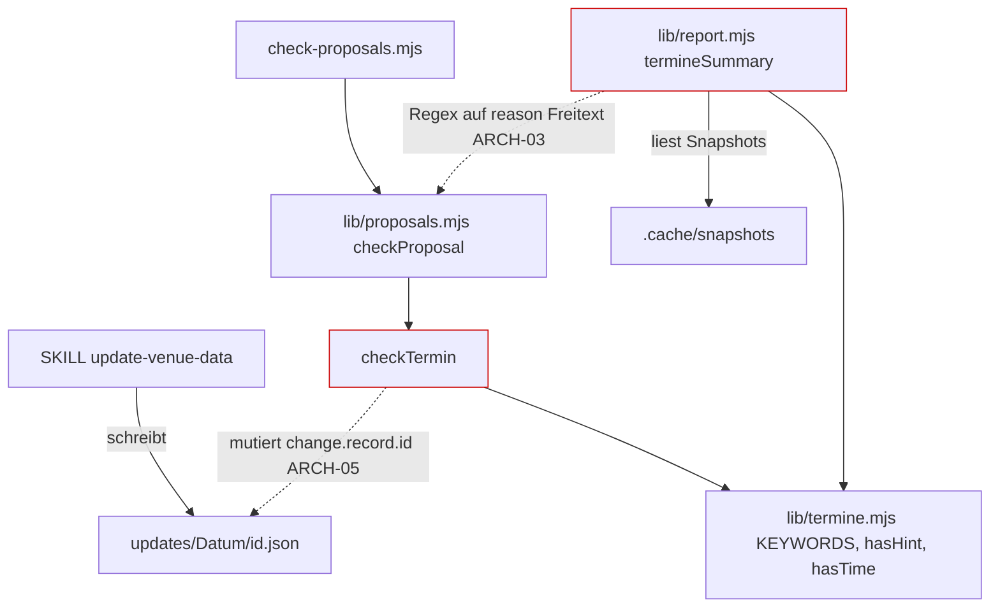

# Architektur-Analyse: Eröffnungs- und Finissagetermine in der Datenaktualisierung (Skripte, Skill, Doku)

**Ticket:** SERVICE-13  
**Analysiert:** 2026-10-30  
**Scope:** Stories SERVICE-13-STORY-01 und -02; uncommittete Änderungen in `scripts/scrape/lib/termine.mjs`, `proposals.mjs`, `report.mjs`, `scripts/scrape/check-proposals.mjs`, `.claude/skills/update-venue-data/SKILL.md`, `updates/README.md`, `test/scrape/termine*.test.mjs`, `test/helpers.mjs`  
**Status:** Entwurf – wartet auf Abnahme  
**Berücksichtigte ADRs / Gherkin:** ADR-001, ADR-006, ADR-007, ADR-010 (übrige ADRs gelesen, nicht betroffen) / `setup/eroeffnungstermine.feature`

**Hinweis zum Skill:** Das Skill-Kriterienraster ist auf Angular zugeschnitten (ADR-022, ADR-008 DSA usw.). Im Scope liegt kein Angular-Code; Angular-spezifische Kriterien (Signals, OnPush, Routing) sind „nicht anwendbar“. Die ADR-Nummern des Skills passen nicht zu diesem Repo; Maßstab sind die ADRs in `docs/architecture/`. `context/AI_CONTEXT.md` existiert nicht (nicht bewertbar). Der Ablageort weicht auf Anweisung vom Skill ab.

---

## 1. Executive Summary

| Kriterium | Bewertung |
|---|---|
| Gesamtarchitektur-Score | 7 / 10 |
| Architektur-Reifegrad | Mittel |
| Komponentenorientierung | Mittel (Modulschnitt der Skripte, nicht Angular) |
| Wartbarkeit | Mittel |
| Testbarkeit | Hoch |
| Technische Schuld | Mittel |
| ADR-Konformität | 1 Verstoß gegen den Geist von ADR-007 (ARCH-01), 1 Lücke bei ADR-010 (ARCH-04) |

Die Änderung fügt sich sauber in die Pipeline aus ADR-006/007 ein: Abruf bleibt unverändert, die Terminlogik liegt als reines, netzfreies Modul in `termine.mjs`, Prüfung und Bericht nutzen dieselben Stichwörter (`KEYWORDS`). Tests laufen mit Fixtures ohne Netz. Schwach ist die deterministische Prüfung selbst: Sie belegt nur, dass der Auszug irgendein Stichwort mit irgendeinem Datum enthält, nicht dass es das vorgeschlagene Datum ist (ARCH-01), und die Uhrzeitprüfung wird von Datumsangaben im Format `7.11.` unterlaufen (ARCH-02). Beides berührt direkt das Schutzziel von ADR-007 und Q-DATA-12. Der Bericht koppelt sich über Freitext-Regex an Verwerfungsgründe (ARCH-03) und markiert Veranstalter-Quellen dauerhaft als „zu prüfen“, obwohl ADR-010 dort keine Events zulässt (ARCH-04). `checkProposal` wächst als lineare if/continue-Kette weiter (ARCH-05).

### Überblick Architektur (Scope)

---

## 2. Analyse nach Kategorien

### Komponentenarchitektur (Modulschnitt)

- **Bewertung:** Mittel
- **Beobachtungen:** `termine.mjs` ist ein sauberes, reines Modul (`scripts/scrape/lib/termine.mjs:1-40`), von Prüfung und Bericht gemeinsam genutzt. `checkProposal` ist jedoch eine ca. 120 Zeilen lange Funktion mit sequenziellen `continue`-Zweigen (`proposals.mjs:92-214`); die Termin-Regel ist als Sonderfall `kind` eingewoben (`proposals.mjs:155-168`).
- **Architektur-Risiko:** Jede weitere datensatzspezifische Regel verlängert die Funktion und verschiebt Reihenfolgeabhängigkeiten (z. B. `needle = null` bei `kind`, Zeile 167).
- **Skalierungsrisiko:** Weitere Terminarten (z. B. Künstlergespräch) brauchen Änderungen an `termine.mjs`, `checkTermin`, Bericht und Skill.
- **Wartbarkeitsauswirkung:** Mittel.

### State Management & Reaktivität

Nicht anwendbar (kein Angular-Code im Scope). Zustand: Dateien (`updates/`, `.cache/`); die Funktionen sind deterministisch, `today` ist injizierbar (`proposals.mjs:92`, `check-proposals.mjs:16`) – gut.

### Service-Schicht

- **Bewertung:** Mittel
- **Beobachtungen:** Der Bericht leitet „vorhanden“ aus dem Wortlaut eines Verwerfungsgrundes ab (`report.mjs:23`: `/Dublette/.test(c.reason)` gegen `proposals.mjs:183`). `termineSummary` liest zudem selbst das Dateisystem (`report.mjs:12-16`), während `proposals` übergeben werden.
- **Architektur-Risiko:** Textänderung am Grund bricht die Zählung lautlos.
- **Skalierungsrisiko:** Weitere Gründe (z. B. `id bereits vergeben`, `proposals.mjs:185`) werden nicht als „vorhanden“ erkannt.
- **Wartbarkeitsauswirkung:** Mittel.

### Struktur & Abhängigkeiten

- **Bewertung:** Stark
- **Beobachtungen:** Keine Zyklen: `proposals.mjs` und `report.mjs` hängen von `termine.mjs`, nicht voneinander ab. Abhängigkeit zur Spezifikation über Kommentare mit OPN-IDs. Die Skill-Doku (`SKILL.md`, `updates/README.md`) und die Prüfung beschreiben dieselben Regeln konsistent (Titelpräfix, `id`, `startDate == endDate`, Beleg).
- **Architektur-Risiko:** Regeln stehen dreifach (Code, SKILL.md, README) ohne Prüfung auf Gleichlauf – Drift möglich (Annahme, kein aktueller Befund).
- **Skalierungsrisiko:** Gering.
- **Wartbarkeitsauswirkung:** Gering.

### Kopplung & Kohäsion

- **Bewertung:** Mittel
- **Beobachtungen:** `checkTermin` mutiert den übergebenen Vorschlag (`proposals.mjs:82` `record.id = id`), obwohl es als Prüffunktion Grund oder `null` liefert. Berichtsquelle ist der Snapshot-Cache, nicht der Lauf (`report.mjs:12`).
- **Architektur-Risiko:** Versteckter Seiteneffekt; Reihenfolge Prüfung/Mutation wird relevant.
- **Skalierungsrisiko:** Gering.
- **Wartbarkeitsauswirkung:** Gering bis mittel.

---

## 3. Prinzipien

### SRP – Score 6
- **Eingehalten:** `termine.mjs` (reine Erkennung), `report.mjs` (Darstellung).
- **Verletzt:** `checkProposal` vereint Zuordnung, Dubletten, Termin, Fundstelle, Schema (`proposals.mjs:92-214`); `checkTermin` prüft und vergibt zugleich `id` (`:82`).
- **Auswirkung:** kognitive Komplexität, Testbarkeit nur über Dateien.

### OCP – Score 5
- **Verletzt:** Neue Regeln erfordern Eingriffe in die Mitte von `checkProposal` (`:155-168`).
- **Auswirkung:** Erweiterbarkeit.

### LSP – Score n. a. (8)
Keine Vererbung; kein Befund.

### ISP – Score 8
- **Eingehalten:** `termine.mjs` exportiert kleine Funktionen; Aufrufer nutzen nur, was sie brauchen.

### DIP – Score 7
- **Eingehalten:** `today` und `root` werden injiziert (`proposals.mjs:92`, `check-proposals.mjs:9`); Tests ohne Netz.
- **Verletzt:** `termineSummary` greift direkt auf `.cache/snapshots` zu (`report.mjs:12`), ohne Parameter für das Verzeichnis.

### Separation of Concerns – Score 6
- **Verletzt:** Bericht kennt Texte der Prüfung (`report.mjs:23`).

### Law of Demeter – Score 7
- Überwiegend eingehalten; `c.record` und `p.changes` werden tief gelesen (`report.mjs:21-23`), für JSON-Daten vertretbar.

---

## 4. Identifizierte Architektur-Schwächen

### ARCH-01: Fundstellenprüfung belegt das vorgeschlagene Datum nicht

- **Priorität:** Hoch
- **Betroffene Stelle:** `scripts/scrape/lib/proposals.mjs:86` (`hasHint(excerpt, kind)`), `:167` (`needle = null` bei Terminen), `scripts/scrape/lib/termine.mjs:29-37`
- **Beschreibung:** `hasHint` prüft nur „Stichwort, dann irgendein Datum in 80 Zeichen“. Ob dieses Datum `record.startDate` entspricht, prüft nichts; der bisherige Abgleich „Wert steht im Textauszug“ (`needle`) ist für Termine bewusst abgeschaltet. Verifiziert: `hasHint('Opening: Saturday, 14 November 2026', 'vernissage')` ergibt `true`, ein Vorschlag mit `startDate` 2026-11-07 würde damit durchgehen.
- **Verletztes Prinzip / ADR:** ADR-007 („verwirft Vorschläge, die keine Fundstelle mit dem Wert im Textauszug haben“); Q-DATA-12 („Datum soll stimmen und auf der Seite stehen“).
- **Konsequenz:** Ein falsches Datum (Tippfehler, Halluzination des Extraktors, Datum einer anderen Veranstaltung im selben Auszug) wird als geprüft vorgelegt; Freigabe stützt sich auf trügerische Prüfung. Test-Fixtures decken diesen Fall nicht ab.
- **Langfristiges Risiko:** Die Prüfung ist die einzige Schutzschicht gegen Halluzinationen (ADR-007, Konsequenzen).

### ARCH-02: Uhrzeit-Erkennung hält Datumsangaben für Uhrzeiten

- **Priorität:** Hoch
- **Betroffene Stelle:** `scripts/scrape/lib/termine.mjs:24` (`TIME`), `scripts/scrape/lib/proposals.mjs:87`
- **Beschreibung:** `\d{1,2}[:.]\d{2}\b` passt auf `7.11` in `7.11.2026`. Verifiziert: `hasTime('Vernissage am 7.11.2026')` ist `true`. Folgen: (a) Enthält der Auszug ein Datum wie `7.11.2026` und die `description` nennt eine erfundene Uhrzeit, gilt die Uhrzeit als belegt (OPN-UN-1 umgangen). (b) Eine `description` mit Datum `07.11.2026` ohne Uhrzeit löst fälschlich die Uhrzeitprüfung aus. Zudem wird nur das Vorhandensein einer Uhrzeit, nicht deren Gleichheit geprüft (`16:00` in der Beschreibung, `4-6pm` im Auszug).
- **Verletztes Prinzip / ADR:** ADR-007; OPN-UN-1; Q-DATA-12 („0 übernommene Uhrzeiten, die nicht im Textauszug stehen“). Der Test (`termine.test.mjs:112-119`) prüft nur `7 November 2026`, nicht das Punktformat.
- **Konsequenz:** Die Qualitätsgrenze von Q-DATA-12 ist mit dem Fixture-Satz erfüllt, aber bei deutschen Seiten (Format `07.11.2026`) nicht belastbar.
- **Langfristiges Risiko:** Überwiegend deutsche Quellen: das Fehlerbild tritt im Normalbetrieb auf.

### ARCH-03: Bericht koppelt sich an den Freitext von Verwerfungsgründen

- **Priorität:** Mittel
- **Betroffene Stelle:** `scripts/scrape/lib/report.mjs:23`, `scripts/scrape/lib/proposals.mjs:183,185`
- **Beschreibung:** „Bereits vorhanden“ wird mit `/Dublette/.test(c.reason)` bestimmt. Eine Terminevent-Kollision über die `id` (`proposals.mjs:82`, `:185`: „id … ist bereits vergeben“) zählt weder als Vorschlag noch als vorhanden und erzeugt „zu prüfen“ trotz vorhandenem Termin.
- **Verletztes Prinzip / ADR:** Separation of Concerns; OPN-EV-1 (Zählung bereits vorhandener).
- **Konsequenz:** Falsche „zu prüfen“-Meldungen; stille Fehlzählung bei Umformulierung.
- **Langfristiges Risiko:** Berichtswerte verlieren Vertrauen.

### ARCH-04: Veranstalter-Quellen erzeugen dauerhaft „zu prüfen“ ohne Möglichkeit eines Vorschlags

- **Priorität:** Mittel
- **Betroffene Stelle:** `scripts/scrape/lib/report.mjs:12-17,28`, `scripts/scrape/lib/proposals.mjs:144-148`
- **Beschreibung:** Der Bericht zählt Hinweise für alle Snapshot-Ordner, auch Veranstalter. Nach ADR-010 darf eine Veranstalter-Website keine `events` ergänzen (`proposals.mjs:144-148` lässt nur Festivals, Festival-Ausstellungen, Veranstalter und Personen zu). Ein Terminhinweis dort kann nie als Vorschlag enden; die Zeile bleibt immer „zu prüfen“. Ob Eröffnungen von Festivalausstellungen (z. B. Photoszene) bewusst nur über die Ort-Website laufen sollen, ist in OPN/ADR-010 nicht entschieden.
- **Verletztes Prinzip / ADR:** ADR-010 (Bereich je Quelle), OPN-EV-1.
- **Konsequenz:** Rauschen im Bericht oder – falls Photoszene-Eröffnungen gewünscht sind – eine Fähigkeitslücke.
- **Langfristiges Risiko:** Nicht erfüllbare „zu prüfen“-Zeilen werden ignoriert.

### ARCH-05: Prüfkette `checkProposal` wächst linear, Prüfregel mutiert Eingabe

- **Priorität:** Niedrig
- **Betroffene Stelle:** `scripts/scrape/lib/proposals.mjs:74-90,155-168`
- **Beschreibung:** `checkTermin` setzt `record.id` (`:82`) als Nebeneffekt der Prüfung; `checkProposal` ist eine ~120-zeilige Kette. Außerdem bezieht der Bericht Snapshots aus dem gesamten Cache (`report.mjs:12`), nicht aus dem Lauf, sodass alte Cache-Stände (`--max-age`, ADR-006) Hinweise erzeugen (Annahme: `listSnapshots` filtert nicht nach Lauf; nicht vertieft geprüft).
- **Verletztes Prinzip / ADR:** SRP, OCP.
- **Konsequenz:** Schwerer zu erweitern und zu testen; Reihenfolge der Prüfungen (Termin vor Fundstelle) ist implizit.
- **Langfristiges Risiko:** Mit weiteren Datensatzarten wird die Funktion unübersichtlich.

---

## 5. Skalierbarkeit & Risiken

- **Wachsende Feature-Anforderungen:** Weitere Terminarten und Quellenarten erfordern jeweils Eingriffe in Prüfkette, Bericht und Skill (ARCH-05).
- **Team-Wachstum:** Regeln liegen in Code, SKILL.md und README; ohne Gleichlauf-Test Drift (nicht belegt).
- **Zunehmende fachliche Komplexität:** Stichwort-plus-Datum-Heuristik (`termine.mjs:3-12`) deckt Formate wie „7th of November“, aber nicht Zeiträume über Monatsgrenzen oder mehrere Termine pro Auszug.

### Top 5 architektonische Risiken

1. Datum nicht an den Auszug gebunden – ARCH-01
2. Uhrzeitbeleg trügerisch bei deutschen Datumsformaten – ARCH-02
3. Bericht koppelt an Freitext – ARCH-03
4. Unerfüllbare „zu prüfen“-Zeilen für Veranstalter – ARCH-04
5. Wachsende Prüfkette – ARCH-05

### Alternative Ansätze (optional)

Verwerfungsgründe als Codes (`{code, reason}`) statt Freitext: Vorteil robuste Zählung, Nachteil Formatänderung der Vorschlagsdateien (`updates/README.md`); alternativ Bericht zählt Dubletten unabhängig über erneute Prüfung des Datensatzes. Keine Umsetzung empfohlen ohne Entscheidung.

---

## 6. Positive Aspekte

- Reines Modul `termine.mjs` mit gemeinsam genutzten `KEYWORDS`, `EVENT_PREFIX`, `ID_SUFFIX`; kein Netz im Bericht (OPN-EV-1), Zeitmessungstest (Q-DATA-13).
- `today` injizierbar; Tests deterministisch, Fixtures mit Szenarionamen gemäß Gherkin, gemeinsamer Helfer `terminEvent` in `test/helpers.mjs`.
- Finissage nur bei ausdrücklichem Beleg (OPN-UB-7) und Zeitprüfung gegen Vergangenheit (OPN-UB-5) im Code verankert.
- Skill und README beschreiben die Regeln deckungsgleich mit der Prüfung.

---

## 7. Bewusst nicht gemeldet

- Kein Headless-Browser, nur statische Seiten: ADR-006.
- Extraktion im Skill statt im Skript, Stichwortzähler statt Parser (in `updates/README.md` ausdrücklich genannt): ADR-007.
- Kein neuer ADR für Terminarten: durch ADR-007/ADR-001 gedeckt (siehe PIPELINE.md).
- Namen wie `venueId` in Berichtszeilen für Veranstalter: ADR-010, Konsequenzen.
- Angular-Kriterien (Signals, OnPush, Routing): nicht im Scope.

---

## 8. Abgeleitete Tasks (Top-Maßnahmen)

| Task | Titel | Priorität | Aufwand | Befunde | Erwartete Wirkung |
|---|---|---|---|---|---|
| [TASK-07](TASK-07-datum-im-textauszug-belegen.md) | Datum des Termins im Textauszug belegen | High | ~1 h | ARCH-01 | Prüfung erfüllt ADR-007 auch für Termine |
| [TASK-08](TASK-08-uhrzeit-erkennung-schaerfen.md) | Uhrzeit-Erkennung von Datumsangaben trennen und Werte abgleichen | High | ~1 h | ARCH-02 | OPN-UN-1 belastbar für deutsche Formate |
| [TASK-09](TASK-09-bericht-entkoppeln-und-veranstalter-klaeren.md) | Berichtszählung entkoppeln; Veranstalter-Termine entscheiden | Medium | ~1,5 h | ARCH-03, ARCH-04 | Zuverlässige „zu prüfen“-Zeilen |
| [TASK-10](TASK-10-pruefkette-strukturieren.md) | Termin-Prüfung ohne Seiteneffekt, Prüfkette gliedern | Low | ~1,5 h | ARCH-05 | Erweiterbarkeit |

---

## 9. Nicht bewertbar

- `context/AI_CONTEXT.md` existiert nicht.
- Verhalten von `listSnapshots` bei alten Cache-Ständen nicht im Detail geprüft (ARCH-05, Annahme).
- Tests wurden nicht ausgeführt; Befunde ARCH-01/02 durch direkte Aufrufe von `hasHint`/`hasTime` belegt.
- Die Testdateien wurden nur stichprobenartig gelesen (`termine.test.mjs`); `termine-bericht.test.mjs` nur Testnamen.
