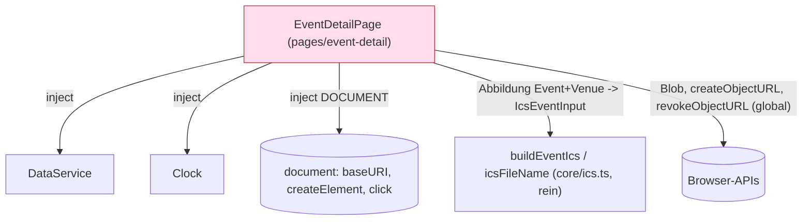

# Architektur-Analyse: SERVICE-14-STORY-01 – Termin in den Gerätekalender übernehmen

**Ticket:** SERVICE-14  
**Analysiert:** 2026-10-30  
**Scope:** Uncommittete Änderungen (Story SERVICE-14-STORY-01): `web/src/app/core/ics.ts`, `ics.spec.ts`, `web/src/app/pages/event-detail/event-detail.{ts,html,css,spec.ts}`  
**Status:** Entwurf – wartet auf Abnahme  
**Berücksichtigte ADRs / Gherkin:** ADR-002, ADR-003, ADR-017, ADR-018 (übrige ADRs gelesen/geprüft, nicht betroffen) / `web/kalender-export.feature`

Hinweis zum Maßstab: Der Skill nennt ADR-Nummern (ADR-004 Signals, -007 OnPush, -011 GenericApiService, -022 u. a.), die es in diesem Repo nicht gibt. Maßstab sind die tatsächlichen ADRs in `docs/architecture/` (ADR-001 bis ADR-018). ADR-002 deckt Standalone, Zoneless/Signals, `core/` und `shared/`, Lazy Loading, Prerendering und Tests.

---

## 1. Executive Summary

| Kriterium | Bewertung |
|---|---|
| Gesamtarchitektur-Score | 8 / 10 |
| Architektur-Reifegrad | Hoch |
| Komponentenorientierung | Mittel |
| Wartbarkeit | Hoch |
| Testbarkeit | Hoch |
| Technische Schuld | Gering |
| ADR-Konformität | vollständig konform (ADR-002, -003, -017, -018); 0 Verstöße |

Die Änderung ist klein und fügt sich sauber ein: `buildEventIcs` ist eine reine Funktion in `core/` ohne Angular-/Browserbezug, wie ADR-018 es verlangt, keine neue Abhängigkeit, keine Netzanfrage. Die Seitenkomponente bleibt standalone, signalbasiert und prerender-tauglich, weil Browser-APIs erst im Klick-Handler laufen. Schwächen liegen an den Rändern: Die Komponente mischt Abbildung (Event/Ort zu `IcsEventInput`), URL-Bildung und Browser-Download (SoC/DIP), der Download ist in einigen Browsern fragil (`revokeObjectURL` direkt nach `click`), und die RFC-5545-/iTIP-Konformität hat Grauzonen (`METHOD:PUBLISH` ohne `ORGANIZER`, kein `TRANSP`, kein `SEQUENCE`). Nichts davon blockiert; keine kritischen Befunde.

### Überblick Architektur (Scope)

Problemstelle (rot): Abbildung, URL-Bildung und Download-Mechanik liegen in `EventDetailPage`.

---

## 2. Analyse nach Kategorien

### Komponentenarchitektur

- **Bewertung:** Mittel
- **Beobachtungen:** `EventDetailPage.saveToCalendar()` (`event-detail.ts:44-65`) erledigt in einer Methode Abbildung des Domänenmodells auf `IcsEventInput` (Z. 49-60), Bildung der absoluten URL aus `document.baseURI` (Z. 58), Blob-/Anker-Download (Z. 61-65). Die Seite wächst von reiner Anzeige zu Anzeige plus Datei-Erzeugung. Die Schaltfläche steckt direkt im Template (`event-detail.html:31-38`), nicht in einer eigenen Komponente; bei einer einzigen Verwendung (ICS-UB-5) angemessen (YAGNI).
- **Architektur-Risiko:** Kommt ein zweiter Export (z. B. Ausstellungen, Festivals) hinzu, wird die Abbildung kopiert.
- **Skalierungsrisiko:** Mittel – Folgevorhaben `startTime`/`endTime` (ADR-018) berührt Komponente und `ics.ts` gleichzeitig.
- **Wartbarkeitsauswirkung:** Gering heute, steigend mit jedem weiteren Export.

### State Management & Reaktivität

- **Bewertung:** Stark
- **Beobachtungen:** Neuer Zustand entsteht nicht; `over()`, `event()`, `venue()` sind bestehende `computed` (`event-detail.ts:28-41`). `saveToCalendar` ist ein imperativer Nutzer-Handler, kein `effect` (richtig). Sichtbarkeit der Schaltfläche per `@if (!over())` (`event-detail.html:31`). Zoneless-kompatibel (ADR-002): kein Zustand wird im Handler verändert.
- **Architektur-Risiko:** Gering. Anmerkung: `today` wird bei Konstruktion eingefroren (`event-detail.ts:22`, bestehend, nicht Teil des Diffs); eine über Mitternacht offene Seite zeigt die Schaltfläche weiter.
- **Skalierungsrisiko:** Gering.
- **Wartbarkeitsauswirkung:** Gering.

### Service-Schicht

- **Bewertung:** Mittel
- **Beobachtungen:** Datenzugriff weiter ausschließlich über `DataService` (ADR-002). `DOCUMENT` per `inject()` (`event-detail.ts:23`) ist korrekt und SSR-sicher. `URL.createObjectURL`/`revokeObjectURL` werden global aufgerufen (`event-detail.ts:62,66`) und im Test über globale Spies ersetzt (`event-detail.spec.ts`, `spyOn(URL, ...)`, `spyOn(HTMLAnchorElement.prototype, 'click')`) – ein Indiz fehlender Abstraktion.
- **Architektur-Risiko:** Browser-Nebenwirkung ohne Naht (Seam).
- **Skalierungsrisiko:** Gering.
- **Wartbarkeitsauswirkung:** Tests greifen in globale Prototypen ein.

### Struktur & Abhängigkeiten

- **Bewertung:** Stark
- **Beobachtungen:** `ics.ts` liegt wie in ADR-018 festgelegt in `core/`, hat keine Importe (kein Zyklus), und `IcsEventInput` ist bewusst vom Datenmodell entkoppelt (`ics.ts:5-21`; Preis: Feldkopie in der Komponente). Die Seite wird weiterhin per `loadComponent` geladen (ADR-002, Routen unverändert). Bundle: kleine Funktion, keine Bibliothek (Q-PERF-4, ADR-018). Prerendering: `buildEventIcs` und Browser-APIs laufen nur im Klick, `DOCUMENT` ist im SSR vorhanden – unkritisch.
- **Architektur-Risiko:** `EVENT_TYPE_LABEL`-Abbildung für die Beschreibung liegt in der Seite (`event-detail.ts:52`), die Fachregel „was steht in LOCATION/DESCRIPTION“ in `ics.ts` – die Aufteilung ist plausibel, aber nicht dokumentiert.
- **Skalierungsrisiko:** Gering.
- **Wartbarkeitsauswirkung:** Gering.

### Kopplung & Kohäsion

- **Bewertung:** Stark
- **Beobachtungen:** `ics.ts` hat hohe Kohäsion (Maskierung, Faltung, Datum, Aufbau; ~85 Zeilen) und ist ohne TestBed testbar (`ics.spec.ts`, Strukturprüfung `expectValid`). Die Komponente koppelt an: `DataService`, `Clock`, `DOCUMENT`, `ics`, `models`, `PageMeta` – für eine Detailseite vertretbar. Die URL wird aus `document.baseURI` abgeleitet (`event-detail.ts:58`): funktioniert unter `base-href` (ADR-003), koppelt aber an den Dokumentzustand zur Klickzeit.
- **Architektur-Risiko:** Gering.
- **Skalierungsrisiko:** Gering.
- **Wartbarkeitsauswirkung:** Gering.

---

## 3. Prinzipien

### SRP – Score 7

- **Eingehalten:** `ics.ts` hat eine Aufgabe; `foldLine`, `escapeText`, `compactDate` sind getrennte Hilfsfunktionen.
- **Verletzt:** `saveToCalendar` (`event-detail.ts:44-67`) mischt Mapping, URL-Bildung, Download.
- **Auswirkung:** Wartbarkeit, Testbarkeit (globale Spies).

### OCP – Score 7

- **Eingehalten:** `IcsEventInput` ist erweiterbar (Uhrzeit-Folgevorhaben ersetzt ICS-UB-2 laut ADR-018 lokal).
- **Verletzt:** Ein zweiter Datensatztyp erzwingt Kopieren der Abbildung.
- **Auswirkung:** Erweiterbarkeit.

### LSP – Score 9

- **Eingehalten:** Keine Vererbung/Abstraktion im Scope; nicht berührt.
- **Verletzt:** –
- **Auswirkung:** –

### ISP – Score 9

- **Eingehalten:** `IcsEventInput` ist ein schmales, auf den Zweck zugeschnittenes Eingabeobjekt statt des Domänen-Events (`ics.ts:5-21`).
- **Verletzt:** –
- **Auswirkung:** Geringe Kopplung.

### DIP – Score 6

- **Eingehalten:** `ics.ts` hängt von nichts ab; `DOCUMENT` wird injiziert; `now` ist injizierbar.
- **Verletzt:** `URL.createObjectURL`/`revokeObjectURL`/`Blob` direkt global (`event-detail.ts:61-66`); `document.baseURI` als implizite Konfiguration.
- **Auswirkung:** Testbarkeit (globale Spies), SSR-Robustheit bei künftiger Nutzung außerhalb des Klicks.

### Separation of Concerns – Score 7

- **Eingehalten:** Dateiformat (Funktion) getrennt von Darstellung (Template/CSS).
- **Verletzt:** Abbildung und Download in der Seitenkomponente.
- **Auswirkung:** Wiederverwendbarkeit.

### Law of Demeter – Score 8

- **Eingehalten:** Kurze Zugriffsketten; Ausnahme `v.address.street/zip/city` (`event-detail.ts:55`) ist Datenzugriff auf ein Modell, vertretbar.
- **Verletzt:** –
- **Auswirkung:** Gering.

---

## 4. Identifizierte Architektur-Schwächen

### ARCH-01: Abbildung Event/Ort zu `IcsEventInput` und URL-Bildung in der Seitenkomponente

- **Priorität:** Mittel
- **Betroffene Stelle:** `web/src/app/pages/event-detail/event-detail.ts:44-60`
- **Beschreibung:** Das Mapping (inkl. Typ-Label, Adressfelder, `new URL('events/<id>', baseURI)`) ist Fachlogik und nur über die Komponente testbar.
- **Verletztes Prinzip / ADR:** SRP, SoC; ADR-002 (gemeinsame Teile unter `core/`)
- **Konsequenz:** Duplikation bei weiteren Exporten; Mapping-Fehler (falsches Feld) werden nur im Komponententest gefunden.
- **Langfristiges Risiko:** Bei `startTime`/`endTime` wächst die Komponente.

### ARCH-02: Browser-Download ohne Naht

- **Priorität:** Niedrig
- **Betroffene Stelle:** `event-detail.ts:61-66`, `event-detail.spec.ts` (globale Spies auf `URL`, `HTMLAnchorElement.prototype`, `window.fetch`, `XMLHttpRequest.prototype`)
- **Beschreibung:** Download-Mechanik ist inline; Tests ersetzen Browser-Prototypen.
- **Verletztes Prinzip / ADR:** DIP, SRP
- **Konsequenz:** Spies auf globalen Prototypen sind fragil bei Testparallelität und verdecken Fehler; der gleiche Mechanismus würde bei Wiederverwendung kopiert.
- **Langfristiges Risiko:** Gering.

### ARCH-03: Download-Robustheit (`revokeObjectURL` sofort, nicht angehängter Anker)

- **Priorität:** Mittel
- **Betroffene Stelle:** `event-detail.ts:62-66`
- **Beschreibung:** `URL.revokeObjectURL(url)` läuft synchron direkt nach `link.click()`. In einigen Browsern (historisch Safari/Firefox; Annahme, nicht im Repo geprüft) kann der Download dadurch scheitern oder leer sein. Der Anker ist nicht im DOM; das funktioniert in aktuellen Browsern meist, ist aber nicht überall garantiert. Q-IOP-1 verlangt ausdrücklich eine Handprobe in Apple und Google, die der Test nicht ersetzt.
- **Verletztes Prinzip / ADR:** Q-IOP-1 (Kompatibilität), ADR-018 (Konsequenzen: Handprobe)
- **Konsequenz:** Möglicher stiller Ausfall der Hauptfunktion auf iOS/Safari, den kein automatisierter Test erkennt.
- **Langfristiges Risiko:** Mittel – Plattformverhalten ändert sich ohne Warnung.

### ARCH-04: RFC-5545-/iTIP-Konformität – `METHOD:PUBLISH` ohne `ORGANIZER`, kein `TRANSP`, kein `SEQUENCE`/`LAST-MODIFIED`

- **Priorität:** Mittel
- **Betroffene Stelle:** `web/src/app/core/ics.ts:66` (`METHOD:PUBLISH`), `ics.ts:67-79` (VEVENT-Felder)
- **Beschreibung:** Siehe Abschnitt RFC-Bewertung unten. Kern: Nach RFC 5546 verlangt `METHOD:PUBLISH` je VEVENT einen `ORGANIZER`; fehlt er, ist das Objekt iTIP-seitig unvollständig. RFC 5545 selbst verlangt `METHOD` nicht; für einen Datei-Download zum Speichern ist das Weglassen üblich und von Outlook/Apple/Google gleichermaßen akzeptiert. Ohne `TRANSP:TRANSPARENT` blockiert ein ganztägiger Eintrag in vielen Kalendern den Tag als „beschäftigt“. Ohne `SEQUENCE`/`LAST-MODIFIED` hat die Aktualisierung bei gleicher `UID` (ICS-UB-3) keine verlässliche Reihenfolge.
- **Verletztes Prinzip / ADR:** ADR-018 (Spezifikation nennt `METHOD` nicht, Entscheidung offen), Q-IOP-1
- **Konsequenz:** Uneinheitliches Importverhalten (Outlook kann `PUBLISH` als Einladung behandeln), Ganztagstermine färben Verfügbarkeit.
- **Langfristiges Risiko:** Mittel.

### ARCH-05: Basis-URL für `URL` aus `document.baseURI`

- **Priorität:** Niedrig
- **Betroffene Stelle:** `event-detail.ts:58`; offen laut `PIPELINE.md` (Konsistenzcheck: „Quelle klärt die Umsetzung (Annahme)“)
- **Beschreibung:** Korrekt unter GitHub Pages mit `base-href` (ADR-003) und später mit eigener Domain. Eine Vorschau-/Mirror-Auslieferung erzeugt jedoch Links auf die Vorschau-Adresse, die dann in Kalendern der Nutzer:innen stehen bleiben. Es gibt (nach Durchsicht von `web/tools/postbuild.mjs`) keinen zentralen Konfigurationswert für die kanonische Basisadresse im Scope; Sitemap/SEO nutzen eigene Wege.
- **Verletztes Prinzip / ADR:** –(Entscheidungslücke, ADR-003)
- **Konsequenz:** Dauerhafte, ggf. tote Links in fremden Kalendern.
- **Langfristiges Risiko:** Niedrig.

### ARCH-06: Qualitätsnachweise lückenhaft (Q-USE-15 axe, Q-IOP-1 Fixtures)

- **Priorität:** Mittel
- **Betroffene Stelle:** `web/tools/quality/browser-check.mjs:13` (`first(/^\/events\/.+/)`), `ics.spec.ts:41-100`
- **Beschreibung:** (a) Der axe-Lauf nimmt das erste prerenderte `/events/:id`; ist es ein beendetes Event, wird die Schaltfläche gar nicht geprüft (Annahme: Reihenfolge der Pfade nicht untersucht). (b) Q-IOP-1 fordert ≥ 6 Fixtures mit Strukturprüfung; `expectValid` existiert (`ics.spec.ts:24-38`), ob jeder Fall sie aufruft, ist zu verifizieren (Szenarien: Inhalt, mehrtägig, Monats-/Jahreswechsel, Maskierung/Faltung, Zeilenumbrüche, Ort unbekannt, ohne Beschreibung). (c) Es fehlt ein Test der Komponente für Q-SEC-6 über echte Netzanfragen – wird per Spy auf `fetch`/XHR abgedeckt, ausreichend, aber `HttpClient`-Anfragen werden damit nicht erfasst (Annahme: `HttpClient` nutzt im Browser `fetch` oder XHR, dann gedeckt).
- **Verletztes Prinzip / ADR:** Q-USE-15, Q-IOP-1
- **Konsequenz:** Zugesagtes Maß (axe 0 Verstöße auf der Schaltfläche) nicht belegt.
- **Langfristiges Risiko:** Gering.

### ARCH-07: Eingabe-Robustheit der reinen Funktion

- **Priorität:** Niedrig
- **Betroffene Stelle:** `ics.ts:44-48` (`compactDate`), `ics.ts:29-30` (`escapeText`), `ics.ts:84` (`icsFileName`)
- **Beschreibung:** `compactDate` prüft das Format nicht (ungültiges Datum erzeugt `NaN` im Ausgabewert), `endDate < startDate` wird nicht erkannt, ein einzelnes `\r` bleibt unmaskiert, `id` geht ungeprüft in Dateiname und `UID`. Das Schema validiert die Daten bereits im Build (ADR-001/-003), daher geringes Risiko.
- **Verletztes Prinzip / ADR:** Q-IOP-1 (100 % gültige Dateien) nur indirekt
- **Konsequenz:** Bei künftigen Datenquellen ohne Schema stille Fehlerdateien.
- **Langfristiges Risiko:** Niedrig.

### ARCH-08: ADR-018 deckt RFC-Details nicht ab

- **Priorität:** Niedrig
- **Betroffene Stelle:** `docs/architecture/ADR-018-ics-im-browser-erzeugen.md`, `ics.ts:12-13` (`PRODID`, `UID_DOMAIN`)
- **Beschreibung:** `PRODID`, `METHOD`, `TRANSP`, `SEQUENCE` und die Form der `UID` (RFC empfiehlt global eindeutig, z. B. mit Domain; `zentrum-praktische-fotografie` ist kein Domainname, praktisch aber eindeutig) sind nicht entschieden dokumentiert.
- **Verletztes Prinzip / ADR:** –
- **Konsequenz:** Spätere Änderung der `UID` oder `PRODID` würde bereits importierte Termine duplizieren, ohne dass die Folgen festgehalten sind.
- **Langfristiges Risiko:** Niedrig bis mittel (UID-Stabilität ist ein Vertrag).

---

## RFC-5545-Konformität (verifiziert am Code `ics.ts`)

| Punkt | Bewertung | Beleg |
|---|---|---|
| Ganztägig (`DTSTART;VALUE=DATE`) | konform | `ics.ts:71`, Format `JJJJMMTT` |
| `DTEND` exklusiv (Folgetag) | konform, Monats-/Jahreswechsel über UTC-Rechnung korrekt und getestet | `ics.ts:72`, `compactDate(..., 1)`, `ics.spec.ts:61` |
| Zeilenfaltung 75 Oktett, Fortsetzung mit Leerzeichen, kein Zerschneiden von Mehrbyte-Zeichen | konform; Zerlegung nach Codepunkten (kombinierende Zeichen/ZWJ-Sequenzen können getrennt werden – unkritisch, Parser entfalten vor Dekodierung) | `ics.ts:32-48`, Fortsetzungsgrenze 74 + 1 Leerzeichen korrekt |
| CRLF, Abschluss-CRLF | konform | `ics.ts:81-82` |
| Textmaskierung (`\\`, `;`, `,`, Zeilenumbruch) | konform (Backslash zuerst); `URL` ist Typ URI und zu Recht unmaskiert | `ics.ts:27` |
| `PRODID` (FPI) | konform: `-//Zentrum fuer Praktische Fotografie//Termine//DE` | `ics.ts:12` |
| Pflichtfelder (`VERSION`, `PRODID`, `UID`, `DTSTAMP`, `DTSTART`) | vorhanden; `DTSTAMP` UTC mit `Z` | `ics.ts:63-79` |
| `METHOD:PUBLISH` ohne `ORGANIZER` | RFC 5545 erlaubt/verlangt `METHOD` nicht; nach RFC 5546 ist `PUBLISH` ohne `ORGANIZER` unvollständig. Empfehlung: `METHOD` weglassen (siehe TASK-03, Entscheidung) | `ics.ts:66` |
| `TRANSP` | fehlt; Standard `OPAQUE` | – |
| `SEQUENCE`/`LAST-MODIFIED` | fehlen; Update-Reihenfolge nur über `DTSTAMP` | – |
| `UID` stabil | konform (`<id>@zentrum-praktische-fotografie`), kein Domainname | `ics.ts:13,69` |

---

## 5. Skalierbarkeit & Risiken

- **Wachsende Feature-Anforderungen:** Uhrzeit (`startTime`/`endTime`), Export von Ausstellungen oder ein Sammel-Export würden Mapping und Download verdoppeln, solange beides in der Seite liegt (ARCH-01/02).
- **Team-Wachstum:** Die reine Funktion plus Strukturprüfung im Test ist ein gutes, leicht erlernbares Muster.
- **Zunehmende fachliche Komplexität:** `VTIMEZONE`, mehrere Termine je Datei, Wiederholungen erfordern ggf. doch eine Bibliothek – ADR-018 hält die Entscheidung bewusst offen.

### Top 5 architektonische Risiken

1. Download scheitert still auf einzelnen Plattformen – ARCH-03.
2. Uneinheitliches Importverhalten durch `METHOD:PUBLISH`/fehlendes `TRANSP` – ARCH-04.
3. UID-/PRODID-Änderung dupliziert Termine bei Nutzer:innen – ARCH-08.
4. Mapping-Duplikation bei weiteren Exporten – ARCH-01/02.
5. Dauerhaft falsche Links bei abweichender Basisadresse – ARCH-05.

### Alternative Ansätze (optional)

- **Download-Hilfsdienst `core/file-download`** (Option A) vs. weiter inline (Option B). A: testbar ohne globale Spies, wiederverwendbar; Mehraufwand ~1 Datei. B: weniger Dateien, aber Spies bleiben. Empfehlung A nur, wenn ein zweiter Export absehbar ist; sonst reicht eine private Methode.
- **Basis-URL**: `document.baseURI` (heute) vs. Build-Konstante vs. Konfiguration. Trade-off: Kanonizität gegen Einfachheit.

---

## 6. Positive Aspekte

- Reine, injizierbare Funktion (`now`) ohne Framework, genau wie ADR-018 es festlegt; keine neue Abhängigkeit.
- Strukturprüfung `expectValid` (CRLF, 75 Oktett, UTF-8, Pflichtfelder) als wiederverwendbares Muster (`ics.spec.ts:24-38`).
- Faltung nach Oktetten statt Zeichen, korrekte Grenze für Fortsetzungszeilen, UTC-Datumsrechnung ohne Sommerzeitfalle.
- Klare Rückverweise auf EARS/Gherkin in Kommentaren und Testnamen; Szenarien und Tests entsprechen sich 1:1.
- Barrierefreiheit: echtes `<button type="button">`, sichtbarer Hinweistext mit `aria-describedby`.
- Prerender-Sicherheit: Browser-APIs nur im Handler.

---

## 7. Bewusst nicht gemeldet

- Keine Bibliothek für iCalendar, kein `VTIMEZONE`, ganztägiger Eintrag: durch ADR-018 entschieden.
- Standalone-Komponente, Signals/`computed`, `inject()`, Lazy Loading, Verzeichnisse `core/` und `pages/`: durch ADR-002 gedeckt.
- Template statt eigener Komponente für die Schaltfläche: nur eine Verwendung (ICS-UB-5), YAGNI.
- Fehlende `HttpClient`-/GenericApiService-Nutzung: im Repo nicht vorgesehen; keine Netzanfrage ist Anforderung (ICS-EV-1).
- Lesbarkeit im Detail (Code) und Sicherheit gehören zu `/review-code` bzw. `/review-security`.

---

## 8. Abgeleitete Tasks (Top-Maßnahmen)

| Task | Titel | Priorität | Aufwand | Befunde | Erwartete Wirkung |
|---|---|---|---|---|---|
| [TASK-01](TASK-01-mapping-nach-core-auslagern.md) | Abbildung Event/Ort zu ICS-Eingabe nach `core/` verlagern | Medium | ~1 h | ARCH-01 | Testbares Mapping, weniger Logik in der Seite |
| [TASK-02](TASK-02-download-hilfsfunktion.md) | Download-Mechanik kapseln | Low | ~1 h | ARCH-02 | Keine globalen Spies, Wiederverwendung |
| [TASK-03](TASK-03-method-publish-entscheiden.md) | `METHOD:PUBLISH` ohne `ORGANIZER` entscheiden | Medium | ~30 min | ARCH-04 | iTIP-konforme Datei |
| [TASK-04](TASK-04-transp-und-sequence.md) | `TRANSP:TRANSPARENT` und Aktualisierungsfelder prüfen | Medium | ~1 h | ARCH-04 | Tag nicht als belegt; verlässliche Updates |
| [TASK-05](TASK-05-download-robustheit.md) | `revokeObjectURL` verzögern, Anker robust behandeln, Handprobe | Medium | ~1 h | ARCH-03 | Download-Zuverlässigkeit |
| [TASK-06](TASK-06-basis-url-entscheiden.md) | Quelle der absoluten Event-URL entscheiden | Low | ~30 min | ARCH-05 | Stabile Links in Kalendern |
| [TASK-07](TASK-07-quality-nachweise.md) | Q-USE-15 (axe) und Q-IOP-1 (Fixtures) belegen | Medium | ~1 h | ARCH-06 | Zusagen der Quality-Datei geprüft |
| [TASK-08](TASK-08-eingaben-robust-machen.md) | Eingabevalidierung in `ics.ts` | Low | ~45 min | ARCH-07 | Keine stillen Fehlerdateien |
| [TASK-09](TASK-09-adr-018-ergaenzen.md) | ADR-018 um RFC-Details und UID-Vertrag ergänzen | Low | ~30 min | ARCH-08, ARCH-04 | Dokumentierte Entscheidungen |

---

## 9. Nicht bewertbar

- Echtes Importverhalten in Apple Kalender, Google Kalender, Outlook (Handprobe; ADR-018 sieht sie vor, hier nicht ausführbar).
- Download-Verhalten auf iOS Safari (ARCH-03 beruht auf Annahme).
- Ausführung von Build, Tests, Lint und axe-Lauf: im Review nicht ausgeführt (nur Lesen erlaubt).
- `context/AI_CONTEXT.md` existiert in diesem Repo nicht; Kontext stattdessen aus `AGENTS.md`, PIPELINE.md und ADRs.
- Frühere Analysen: keine vorhanden im Review-Ordner (andere Reviews laufen parallel).
