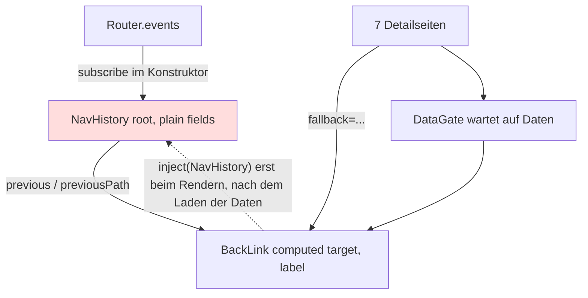
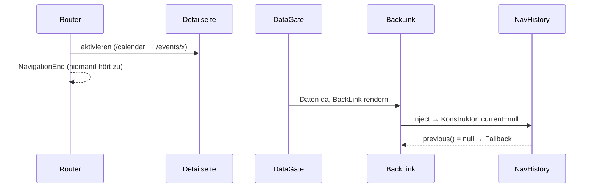

# Architektur-Analyse: Zurück-Link auf Detailseiten (SERVICE-18-STORY-01)

**Ticket:** SERVICE-18  
**Analysiert:** 2026-11-02  
**Scope:** `web/src/app/core/nav-history.ts`, `web/src/app/shared/back-link/*`, sieben `pages/*-detail/*` (Branch-Diff gegen main plus nicht committierte Dateien), ADR-022, `docs/ears/web/navigation.md`, `docs/contracts/gherkin/web/navigation.feature`, `docs/quality/web/navigation.md`  
**Status:** Entwurf – wartet auf Abnahme  
**Berücksichtigte ADRs / Gherkin:** ADR-002, ADR-003, ADR-022 (alle 22 ADRs gelesen) / `web/navigation.feature`

---

## 1. Executive Summary

| Kriterium | Bewertung |
|---|---|
| Gesamtarchitektur-Score | 6 |
| Architektur-Reifegrad | Mittel |
| Komponentenorientierung | Stark |
| Wartbarkeit | Mittel |
| Testbarkeit | Mittel |
| Technische Schuld | Gering |
| ADR-Konformität | vollständig konform in der Struktur; 1 funktionale Abweichung von der Absicht von ADR-022 (ARCH-01) |

Die Struktur folgt ADR-022: ein kleiner Root-Dienst (`NavHistory`), eine gemeinsame Standalone-Komponente (`BackLink`) für alle sieben Detailseiten, echter `<a>`-Link, keine Persistenz, keine Abhängigkeit. Verantwortlichkeiten sind sauber getrennt, der Sonderlink auf `/photographers/:id` ist ersetzt. Das Hauptproblem ist der Lebenszyklus von `NavHistory`: Der Dienst wird erst beim ersten Rendern eines `BackLink` erzeugt, also nach dem ersten Navigationsereignis der Detailseite. Dadurch dürfte der Zurück-Link beim ersten Detailaufruf nach dem Laden auf die Übersicht statt auf die vorherige Seite zeigen (NAV-EV-2). Die Tests verdecken das, weil sie den Dienst vorab selbst injizieren. Zweitens liest `computed` nicht reaktive Felder. Beides lässt sich klein beheben.

### Überblick Architektur (Scope)

---

## 2. Analyse nach Kategorien

### Komponentenarchitektur

- **Bewertung:** Stark
- **Beobachtungen:** Eine Komponente für sieben Seiten (`back-link.ts:35-49`), Eingabe `fallback` als `input.required` (`back-link.ts:45`), Einbindung je Seite an gleicher Stelle direkt nach dem `@if` (`pages/*/*.html:3`). Die Komponente enthält keine Datenlogik. Die Beschriftung kommt aus einer reinen, exportierten Funktion `targetLabel` (`back-link.ts:28-32`).
- **Architektur-Risiko:** gering
- **Skalierungsrisiko:** Ein neuer Seitentyp braucht Änderungen an mehreren Stellen (ARCH-03).
- **Wartbarkeitsauswirkung:** positiv, die Gestaltung liegt an einer Stelle.

### State Management & Reaktivität

- **Bewertung:** Mittel
- **Beobachtungen:** `NavHistory` hält `current`/`before` als einfache Felder (`nav-history.ts:8-9`), `BackLink.target`/`label` sind `computed` (`back-link.ts:47-48`). `computed` wird nicht erneut berechnet, wenn sich nur `before` ändert (ARCH-02). Die Router-Subscription (`nav-history.ts:12`) hat keine Lifecycle-Bindung; bei einem `providedIn: 'root'`-Singleton ist das vertretbar (siehe Abschnitt 7). Zoneless und OnPush-Annahmen: Die Komponente ist signalbasiert, aber der Dienst nicht.
- **Architektur-Risiko:** mittel (ARCH-01, ARCH-02)
- **Skalierungsrisiko:** Weitere Verbraucher des Verlaufs (z. B. Scroll- oder Filter-Wiederherstellung, ADR-022 „Folgevorhaben“) erben das Problem.
- **Wartbarkeitsauswirkung:** Fehler wären nur im echten Ablauf sichtbar (siehe Tests).

### Service-Schicht

- **Bewertung:** Stark
- **Beobachtungen:** `NavHistory` ist klein, ohne HTTP, mit `inject()` und `providedIn: 'root'` (`nav-history.ts:5-10`), konsistent mit `core/`-Diensten wie `DataService`. Kein God Service.
- **Architektur-Risiko:** gering
- **Skalierungsrisiko:** gering
- **Wartbarkeitsauswirkung:** positiv

### Struktur & Abhängigkeiten

- **Bewertung:** Stark
- **Beobachtungen:** Abhängigkeitsrichtung `pages → shared/back-link → core/nav-history` ohne Zyklen. Detailseiten sind per `loadComponent` lazy (`app.routes.ts:10-71`); `NavHistory` liegt im Hauptbündel-Kontext, wird aber nicht früh genutzt (ARCH-01). Die Routenkenntnis (Pfade und Bezeichnungen) steckt in `shared/back-link/back-link.ts:5-25` (ARCH-03).
- **Architektur-Risiko:** gering
- **Skalierungsrisiko:** gering bis mittel (ARCH-03)
- **Wartbarkeitsauswirkung:** gut

### Kopplung & Kohäsion

- **Bewertung:** Mittel
- **Beobachtungen:** Hohe Kohäsion in beiden Dateien. Verdeckte Kopplung: `BackLink` funktioniert nur, wenn `NavHistory` schon vor der ersten Navigation existiert, ohne dass dies irgendwo erzwungen wird (`app.config.ts:16-23` enthält keinen Initialisierer). Die Tests erzwingen die Reihenfolge von Hand (`back-link.spec.ts:11`).
- **Architektur-Risiko:** mittel
- **Skalierungsrisiko:** gering
- **Wartbarkeitsauswirkung:** Testbarkeit ist gut (Router-Harness), aber das Testsetup bildet den Produktivstart nicht ab.

---

## 3. Prinzipien

### SRP – Score 9
- **Eingehalten:** Verlauf (`nav-history.ts`) und Darstellung (`back-link.ts`) getrennt.
- **Verletzt:** `back-link.ts` enthält zusätzlich die Routenbezeichnungen (leichte Nebenverantwortung, ARCH-03).
- **Auswirkung:** Wartbarkeit.

### OCP – Score 6
- **Eingehalten:** Neue Detailseiten binden die Komponente nur ein.
- **Verletzt:** Neue Seitentypen erfordern Änderung der Maps `OVERVIEWS`/`DETAILS` (`back-link.ts:5-25`) und der Sonderfall `/calendar` (`back-link.ts:30`).
- **Auswirkung:** Erweiterbarkeit.

### LSP – Score 9
- Nicht berührt; keine Vererbung. Keine Verletzung.

### ISP – Score 9
- **Eingehalten:** Der Dienst bietet zwei schmale Methoden (`nav-history.ts:19-26`); `previous()` und `previousPath()` parsen/zerlegen denselben String zweifach, eine Kleinigkeit.
- **Auswirkung:** gering.

### DIP – Score 7
- **Eingehalten:** `BackLink` hängt an der Dienst-Abstraktion `NavHistory` via `inject()`.
- **Verletzt:** Keine Abstraktion über den Router; für diese Größe angemessen (YAGNI).
- **Auswirkung:** Testbarkeit akzeptabel.

### Separation of Concerns – Score 7
- **Eingehalten:** Router-Beobachtung im Dienst, Darstellung in der Komponente, Fallback in den Seiten.
- **Verletzt:** Der Lebenszyklus (wann beginnt die Beobachtung?) ist an die Darstellung gekoppelt (ARCH-01).
- **Auswirkung:** Korrektheit, Kopplung.

### Law of Demeter – Score 9
- Keine Ketten über fremde Objekte; `e.urlAfterRedirects` ist ein Ereignisfeld. Keine Verletzung.

---

## 4. Identifizierte Architektur-Schwächen

### ARCH-01: `NavHistory` wird zu spät erzeugt – erster Zurück-Link zeigt vermutlich immer auf die Übersicht

- **Priorität:** Hoch
- **Betroffene Stelle:** `web/src/app/core/nav-history.ts:10-16`, `web/src/app/shared/back-link/back-link.ts:42`, `web/src/app/app.config.ts:16-23`, `web/src/app/shared/data-gate/data-gate.ts:9-18`, `web/src/app/shared/back-link/back-link.spec.ts:11`
- **Beschreibung:** Die Router-Subscription entsteht erst im Konstruktor, und der wird erst beim ersten Rendern eines `BackLink` ausgelöst. Dieser steht in jeder Detailseite innerhalb von `app-data-gate` im `@if` (`pages/*/*.html:2-3`) und wird damit frühestens bei Datenbereitschaft, in der Regel nach `NavigationEnd` der Detailseite, erzeugt. Dann sind `current` und `before` leer; `previous()` liefert `null` und der Link zeigt auf die Übersicht, obwohl die Seite aus der App erreicht wurde (z. B. Kalender → Event). Erst ab der zweiten Navigation arbeitet der Dienst. Der Spec-Setup ruft `TestBed.inject(NavHistory)` vor der Navigation auf (`back-link.spec.ts:11`) und verdeckt das.
- **Verletztes Prinzip / ADR:** ADR-022 (Absicht: „merkt sich per Router-Ereignissen, ob die aktuelle Seite aus einer anderen Seite erreicht wurde“), NAV-EV-2, Q-USE-16 (100 % Zielgenauigkeit), Separation of Concerns.
- **Konsequenz:** NAV-EV-2 ist im echten Betrieb beim ersten Detailaufruf (und nach jedem Neuladen) nicht erfüllt. Die Abweichung ist durch Codelektüre belegt, aber **nicht durch einen Lauf** (Annahme: reiner Browserstart ohne vorherigen Zugriff auf den Dienst; bei Hydration ebenso).
- **Langfristiges Risiko:** Weitere Verbraucher des Verlaufs erben die verdeckte Reihenfolge-Abhängigkeit.

### ARCH-02: Nicht reaktiver Zustand in `computed`

- **Priorität:** Mittel
- **Betroffene Stelle:** `nav-history.ts:8-9,19-26`, `back-link.ts:47-48`
- **Beschreibung:** `target`/`label` hängen nur von `fallback` ab; `previous()` liest einfache Felder und löst keine Neuberechnung aus. Bleibt die Komponente bei einem Wechsel zwischen Seiten desselben Typs erhalten (Router-Wiederverwendung von `/venues/:id`, Annahme, nicht geprüft), zeigt der Link das alte Ziel.
- **Verletztes Prinzip / ADR:** Signals/Zoneless-Konsistenz (ADR-002: Angular-SPA, projektweit `provideZonelessChangeDetection`), Kohäsion von Zustand und Reaktivität.
- **Konsequenz:** Veraltete Linkziele sind nicht auszuschließen; zusätzlich wird `previous()` bei jeder Auswertung neu geparst.
- **Langfristiges Risiko:** Folgefunktionen (Scroll-/Filter-Wiederherstellung) brauchen reaktiven Verlauf.

### ARCH-03: Routenwissen an mehreren Stellen dupliziert

- **Priorität:** Niedrig
- **Betroffene Stelle:** `back-link.ts:5-32`, `pages/*/*.html:3` (sieben Fallbacks), `app.routes.ts`
- **Beschreibung:** Übersichtsadressen und Bezeichnungen stehen in `OVERVIEWS`/`DETAILS`, die Fallbacks einzeln in den Templates, die Pfade in den Routen. Ein neuer Seitentyp erfordert drei Änderungen; ein Test (`back-link.spec.ts:21-29`) prüft nur die heutigen sieben.
- **Verletztes Prinzip / ADR:** OCP, DRY (strukturell).
- **Konsequenz:** geringes Auseinanderlaufrisiko bei neuen Seitentypen.
- **Langfristiges Risiko:** gering; erst bei weiteren Seitentypen relevant.

---

## 5. Skalierbarkeit & Risiken

- **Wachsende Feature-Anforderungen:** Scroll- und Filterwiederherstellung (ADR-022 „Folgevorhaben“) brauchen einen reaktiven, früh gestarteten Verlauf (ARCH-01, ARCH-02).
- **Team-Wachstum:** Die implizite Initialisierungsreihenfolge ist schwer zu entdecken; Tests verdecken sie.
- **Zunehmende fachliche Komplexität:** Neue Seitentypen betreffen drei Stellen (ARCH-03).

### Top 5 architektonische Risiken

1. Verlauf startet zu spät, NAV-EV-2 im echten Ablauf nicht erfüllt – ARCH-01
2. Test-Setup bildet den Produktivstart nicht ab – ARCH-01
3. Veraltetes Linkziel bei Komponentenwiederverwendung – ARCH-02
4. Routenwissen verteilt – ARCH-03
5. – (keine weiteren)

### Alternative Ansätze (optional)

Statt eines eigenen Dienstes könnte die Router-Navigation `state` (`navigationExtras.state`) oder `Navigation.previousNavigation` nutzen. Trade-off: weniger Zustand, aber nicht jeder Link setzt den State, und ADR-022 hat die Variante nicht betrachtet. Keine Empfehlung; nur falls ADR-022 überarbeitet wird.

---

## 6. Positive Aspekte

- Schlanke Lösung ohne neue Abhängigkeit, ohne Persistenz (ADR-022).
- Eine Komponente statt sieben Kopien, Sonderlink entfernt, CSS an einer Stelle (`photographer-detail.css` bereinigt).
- Echter `<a href>`, Fallback im vorgerenderten HTML (ADR-002/003).
- Reine Funktion `targetLabel` getrennt testbar; Spezifikation (EARS, Gherkin, Quality, ADR) vollständig, ID-Verweise nur von der Planung zur Spezifikation.
- Tests über `RouterTestingHarness` mit echten Routen.

---

## 7. Bewusst nicht gemeldet

- Router-Subscription ohne `takeUntilDestroyed` (`nav-history.ts:12`): Root-Singleton mit Anwendungslebensdauer.
- Kein `sessionStorage`: ausdrücklich per ADR-022 ausgeschlossen. Leerer Verlauf nach Neuladen ist dort als Konsequenz vermerkt.
- Zyklen zwischen Detailseiten (A↔B): in ADR-022 als gewollt dokumentiert.
- Fehlende Wiederherstellung von Filter und Scrollposition: ADR-022 „Folgevorhaben“.
- Ein ausgeblendeter Zurück-Link bei laufendem Datenladen: Ergebnis der vorhandenen `DataGate`-Struktur und nicht Teil dieses Scopes (der Fallback im Vorrendern hängt allerdings davon ab, ob die Daten dort bereits geladen werden; nicht geprüft).

---

## 8. Abgeleitete Tasks (Top-Maßnahmen)

| Task | Titel | Priorität | Aufwand | Befunde | Erwartete Wirkung |
|---|---|---|---|---|---|
| [TASK-01](TASK-01-navhistory-frueh-starten-und-reaktiv.md) | NavHistory beim Start erzeugen und reaktiv halten | High | ~1,5 h | ARCH-01, ARCH-02 | NAV-EV-2 gilt auch beim ersten Detailaufruf; Test bildet den Produktivstart ab |
| [TASK-02](TASK-02-routenwissen-buendeln.md) | Routenwissen für Zurück-Ziele bündeln | Low | ~1 h | ARCH-03 | Neue Seitentypen an einer Stelle pflegen |

---

## 9. Nicht bewertbar

- Das Laufzeitverhalten (Befund ARCH-01/02) wurde nicht ausgeführt; Tests und Build wurden nach Vorgabe nicht verändert. Aussage beruht auf Codelektüre.
- Der Skill verweist auf ADR-Nummern (z. B. ADR-004 Signals, ADR-007 OnPush, ADR-011 GenericApiService), die in diesem Repository andere Themen haben; es gibt außerdem weder `context/AI_CONTEXT.md` noch `docs/product/contracts` oder `docs/product/planning`. Die Prüfung erfolgte gegen die tatsächlich vorhandenen ADRs (002, 003, 022). Bestehende Review-Ordner gab es nicht.
- `eslint.config.js`, `angular.json` und `tsconfig*` wurden nicht im Detail geprüft; Prerender-Verhalten des Fallback-Links vor Datenbereitschaft ist nicht verifiziert.
