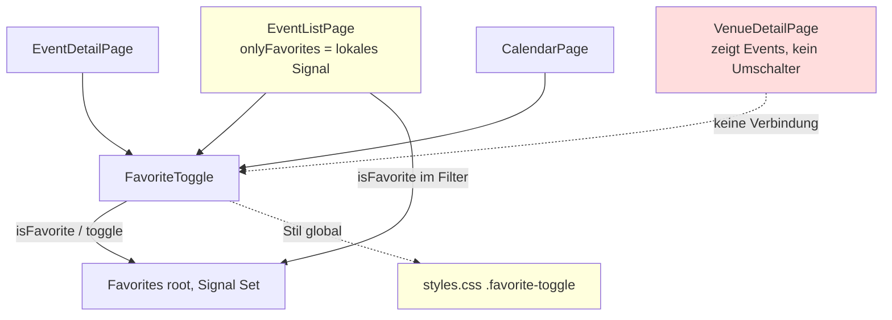

# Architektur-Analyse: Events favorisieren (SERVICE-19-STORY-01)

**Ticket:** SERVICE-19  
**Analysiert:** 2026-11-02  
**Scope:** `web/src/app/core/favorites.ts`, `web/src/app/shared/favorite-toggle/*`, die Favoriten-Änderungen in `pages/event-list/*`, `pages/event-detail/*`, `pages/calendar/*`, `web/src/styles.css` (Branch-Diff plus nicht committierte Dateien); `docs/ears/web/favoriten.md`, `docs/contracts/gherkin/web/favoriten.feature`, `docs/quality/web/favoriten.md`, ADR-023, Changelog der Story  
**Status:** Entwurf – wartet auf Abnahme  
**Berücksichtigte ADRs / Gherkin:** ADR-001 bis ADR-023 (alle gelesen; maßgeblich ADR-002, ADR-022, ADR-023) / `web/favoriten.feature`

---

## 1. Executive Summary

| Kriterium | Bewertung |
|---|---|
| Gesamtarchitektur-Score | 8 |
| Architektur-Reifegrad | Hoch |
| Komponentenorientierung | Stark |
| Wartbarkeit | Hoch |
| Testbarkeit | Hoch |
| Technische Schuld | Gering |
| ADR-Konformität | vollständig konform mit ADR-023 und ADR-002; 1 Lücke zwischen Spezifikation und Umsetzung (ARCH-01) |

Die Umsetzung folgt ADR-023 genau: ein Root-Dienst `Favorites` mit einem Signal als einziger Zustandsquelle, keine Persistenz, eine gemeinsame Standalone-Komponente `FavoriteToggle` für Liste, Detail und Agenda, der Filter in der Eventliste nutzt dieselbe Menge. Abhängigkeiten laufen in eine Richtung (`pages → shared/favorite-toggle → core/favorites`), es gibt keine Zyklen und keine neue Abhängigkeit. Die Schwächen sind klein: Ein Event erscheint auch auf der Ortsdetailseite ohne Umschalter, obwohl FAV-UB-2 „alle Seiten, die das Event zeigen“ nennt (ARCH-01). Der Filterzustand „Nur Favoriten“ liegt als Komponentenzustand in der Seite und geht beim Hin- und Zurückwechseln verloren, während der Typfilter in der Adresse überlebt (ARCH-02). Die Stile der Umschalter liegen global in `styles.css`, anders als bei den übrigen `shared/`-Komponenten (ARCH-03).

### Überblick Architektur (Scope)

---

## 2. Analyse nach Kategorien

### Komponentenarchitektur

- **Bewertung:** Stark
- **Beobachtungen:** Eine Präsentationskomponente für drei Seiten (`favorite-toggle.ts:1-19`) mit zwei Pflichteingaben `eventId`/`title` (`favorite-toggle.ts:15-16`); keine Datenlogik, nur Anzeige und Delegation an den Dienst. Einbindung an je einer Stelle (`event-list.html:42`, `event-detail.html:15`, `calendar.html:43-45`); die Agenda blendet Ausstellungen mit `@if (item.kind === 'Event')` aus (FAV-UB-1). `EventListPage` bleibt klein (57 Zeilen); der Filter ist ein einziges zusätzliches Prädikat (`event-list.ts:45`).
- **Architektur-Risiko:** gering
- **Skalierungsrisiko:** Weitere Orte, die Events zeigen, müssen die Komponente einzeln einbinden (ARCH-01).
- **Wartbarkeitsauswirkung:** positiv; Anzeige und Barrierefreiheit (Q-USE-17) liegen an einer Stelle.

### State Management & Reaktivität

- **Bewertung:** Stark
- **Beobachtungen:** Ein unveränderliches `Set` in einem `signal` (`favorites.ts:6`), `toggle` erzeugt bei jeder Änderung ein neues Set (`favorites.ts:14-18`), sodass Signal-Gleichheit und `computed` korrekt auslösen. `pressed` ist `computed` aus Eingabe und Dienst (`favorite-toggle.ts:18`); `EventListPage.items` liest `onlyFavorites()` und `isFavorite` innerhalb von `computed` (`event-list.ts:39-48`), also reaktiv. Kein `effect`, keine Subscription, kein RxJS. Das Projekt läuft zoneless mit `provideClientHydration(withEventReplay())` (`app.config.ts:26`); der Zustand ist beim Vorrendern leer und passt zum vorgerenderten HTML (ADR-023 „Konsequenzen“). Zweite Zustandsquelle: `onlyFavorites` als Seitenzustand (`event-list.ts:23`, ARCH-02).
- **Architektur-Risiko:** gering
- **Skalierungsrisiko:** Mit weiteren Filtern wächst der verstreute lokale Zustand (ARCH-02).
- **Wartbarkeitsauswirkung:** gut; die Reaktivität ist von der Signal-Kette getragen und nicht von Konventionen.

### Service-Schicht

- **Bewertung:** Stark
- **Beobachtungen:** `Favorites` ist ein kleiner Domain-Dienst der Wurzel (`favorites.ts:4-5`) ohne HTTP, ohne Browser-Speicher, mit drei Mitgliedern (`count`, `isFavorite`, `toggle`). Konsistent mit `core/`-Diensten wie `NavHistory`. `count` wird im Produktivcode nirgends verwendet, nur in `favorite-toggle.spec.ts:79,83` (siehe Abschnitt 7, YAGNI-nah). Die Menge ist nicht gegen vorhandene Event-IDs geprüft; eine unbekannte ID bliebe stumm im Set (gegenwärtig nicht erreichbar, da nur gerenderte Events umschalten).
- **Architektur-Risiko:** gering
- **Skalierungsrisiko:** gering; eine spätere Persistenz bliebe hinter `isFavorite`/`toggle` kapselbar (ADR-023 „Konsequenzen“).
- **Wartbarkeitsauswirkung:** positiv

### Struktur & Abhängigkeiten

- **Bewertung:** Stark
- **Beobachtungen:** Richtung `pages → shared/favorite-toggle → core/favorites`, `EventListPage` greift zusätzlich direkt auf `core/favorites` zu (`event-list.ts:8,21`), das ist zulässig. Feature-/Ordnerstruktur wie bei `back-link` und `exhibition-badges`. Keine Änderung an Routen (`app.routes.ts`), die Seiten bleiben lazy. Abweichung: `venue-detail.html:45-51` zeigt Events ohne Umschalter (ARCH-01); Stile sind nicht mit der Komponente gebündelt (ARCH-03).
- **Architektur-Risiko:** gering
- **Skalierungsrisiko:** gering
- **Wartbarkeitsauswirkung:** gut

### Kopplung & Kohäsion

- **Bewertung:** Stark
- **Beobachtungen:** Hohe Kohäsion in `favorites.ts` und `favorite-toggle.ts`. Die einzige verdeckte Kopplung ist die zur globalen Klasse `.favorite-toggle` und zu `.visually-hidden` in `styles.css:79-80,82` (ARCH-03). Die Tests laufen über Seiten mit Router-Harness und neuer Testmodul-Instanz je Szenario und bilden Neuladen und Seitenwechsel realistisch ab (`favorite-toggle.spec.ts:31,80`). Sie koppeln sich allerdings an den sichtbaren Text („`: Titel`“, `favorite-toggle.spec.ts:24`) und an die Struktur der Seiten (`ul.card-list`, `.filters`).
- **Architektur-Risiko:** gering
- **Skalierungsrisiko:** gering
- **Wartbarkeitsauswirkung:** Die Testbarkeit ist gut; Textänderungen am Umschalter brechen mehrere Seitentests gleichzeitig (siehe Abschnitt 7).

---

## 3. Prinzipien

### SRP – Score 9
- **Eingehalten:** Zustand (`favorites.ts`), Anzeige (`favorite-toggle.ts`), Filterung (`event-list.ts:45`) sind getrennt.
- **Verletzt:** –
- **Auswirkung:** Wartbarkeit.

### OCP – Score 7
- **Eingehalten:** Neue Seiten mit Events binden nur die Komponente ein.
- **Verletzt:** Jede Seite muss die Einbindung selbst bedenken; ein Ort wurde nicht bedacht (`venue-detail.html:45-51`, ARCH-01).
- **Auswirkung:** Erweiterbarkeit, Konsistenz (FAV-UB-2).

### LSP – Score 9
- Keine Vererbung; keine Verletzung.

### ISP – Score 9
- **Eingehalten:** Der Dienst bietet drei schmale Mitglieder; die Komponente nimmt nur `eventId` und `title`.
- **Auswirkung:** gering.

### DIP – Score 8
- **Eingehalten:** Komponente und Seite hängen am Dienst über `inject()`; die Speicherart ist hinter `isFavorite`/`toggle` verborgen.
- **Verletzt:** Keine Abstraktion über den Dienst; für die Größe angemessen (YAGNI).
- **Auswirkung:** Testbarkeit gut, Persistenz später ersetzbar.

### Separation of Concerns – Score 8
- **Eingehalten:** Zustand im Dienst, Darstellung in der Komponente, Seitenfilter in der Seite.
- **Verletzt:** Teilzustand des Filters lokal, Teil davon (Typ) in der Adresse (`event-list.ts:23,34-37`, ARCH-02); Stil außerhalb der Komponente (ARCH-03).
- **Auswirkung:** Konsistenz, Kohäsion.

### Law of Demeter – Score 9
- Keine Ketten über fremde Objekte. `$any($event.target).checked` in `event-list.html:14` ist eine Template-Eigenheit, keine strukturelle Verletzung.

---

## 4. Identifizierte Architektur-Schwächen

### ARCH-01: Ortsdetailseite zeigt Events ohne Umschalter – FAV-UB-2 und FAV-UB-1 passen nicht zusammen

- **Priorität:** Mittel
- **Betroffene Stelle:** `web/src/app/pages/venue-detail/venue-detail.html:45-51`, `docs/ears/web/favoriten.md` (FAV-UB-1 vs. FAV-UB-2)
- **Beschreibung:** FAV-UB-2 verlangt, den Zustand „auf allen Seiten, die das Event zeigen“ einheitlich anzuzeigen. Die Ortsdetailseite listet Events (`@for (event of events(); track event.id)`) mit Titel und Zeitraum, aber ohne Umschalter und ohne Zustandsanzeige. FAV-UB-1 zählt dagegen nur Liste, Detail und Agenda auf. Die Spezifikation widerspricht sich also, und die Umsetzung folgt der engeren Fassung. Annahme: Weitere Seiten (Startseite, Fotografen, Festivals) zeigen nach der Suche in `pages/` und `core/` keine Events; nicht durch Lauf geprüft.
- **Verletztes Prinzip / ADR:** FAV-UB-2, OCP (Einbindung je Seite), Konsistenz; ADR-023 nennt „Liste, Detail und Agenda“ und bleibt damit konform.
- **Konsequenz:** Ein markiertes Event erscheint auf `/venues/:id` ohne Markierung; Besucher:innen sehen dort einen scheinbar nicht gemerkten Favoriten.
- **Langfristiges Risiko:** Jede weitere Seite mit Events wiederholt die Lücke; es gibt keine Prüfung, die „zeigt Event“ ↔ „hat Umschalter“ absichert.

### ARCH-02: „Nur Favoriten“ ist flüchtiger Seitenzustand, der Typfilter liegt in der Adresse

- **Priorität:** Mittel
- **Betroffene Stelle:** `web/src/app/pages/event-list/event-list.ts:23,39-48`, `web/src/app/pages/event-list/event-list.html:13-16`, `web/src/app/shared/back-link/back-link.ts` (Rückkehr nach `/events`)
- **Beschreibung:** `onlyFavorites` ist ein `signal(false)` der Seitenkomponente. Wer mit „Nur Favoriten“ ein Event öffnet und über den Zurück-Link (ADR-022) zur Liste zurückkehrt, bekommt eine neue Komponenteninstanz mit `false`; der Typfilter dagegen bleibt, weil er Query-Parameter ist (`event-list.ts:34-37,54-56`). Ein URL-Parameter für Favoriten ist durch ADR-023 ausgeschlossen („URL-Parameter … nicht gewünscht“). Übrig bleibt eine Entscheidung, wo der Filterzustand der Sitzung lebt.
- **Verletztes Prinzip / ADR:** Separation of Concerns (zwei Mechanismen für denselben Filterzustand), FAV-UB-2 sinngemäß (Zustand „beim Wechsel zwischen den Seiten beibehalten“ gilt für Markierungen, nicht für die Filterauswahl; die Spezifikation äußert sich dazu nicht). ADR-023 bleibt konform.
- **Konsequenz:** Der zentrale Anwendungsfall „Favoriten ansehen, Detail öffnen, zurück“ stellt die gefilterte Liste nicht wieder her. Annahme: kein Gherkin-Szenario deckt das ab.
- **Langfristiges Risiko:** Weitere Filter (Idee 011) erben zwei Zustandsorte und uneinheitliches Verhalten beim Zurückkehren.

### ARCH-03: Umschalter-Stile liegen global statt an der Komponente

- **Priorität:** Niedrig
- **Betroffene Stelle:** `web/src/styles.css:79-80`, `web/src/app/shared/favorite-toggle/favorite-toggle.ts:5-12`
- **Beschreibung:** `FavoriteToggle` hat keine eigenen Stile. Zielgröße (`min-height/min-width 2rem`, Q-USE-17) und gedrückter Zustand stehen in der globalen `styles.css`. Die übrigen `shared/`-Komponenten mit eigenem Aussehen kapseln es selbst (`styleUrl`/`styles` in `back-link`, `exhibition-badges`, `venue-legend`, `venue-map`, per Suche belegt).
- **Verletztes Prinzip / ADR:** Kohäsion, Komponentenorientierung; keine ADR-Verletzung.
- **Konsequenz:** Die Komponente trägt Q-USE-17 nicht allein; wird sie anderswo verwendet oder `styles.css` umgebaut, fällt die Zielgröße unbemerkt weg.
- **Langfristiges Risiko:** gering; Streuung der Komponentenstile.

---

## 5. Skalierbarkeit & Risiken

- **Wachsende Feature-Anforderungen:** Persistenz, Teilen oder weitere Filter (Idee 011) sind an `Favorites` sauber anschließbar; ein Wechsel von Event auf weitere Typen erfordert eine Typisierung der Menge (heute `string`-IDs ohne Typ-Präfix, ADR-023 „Nur Events“).
- **Team-Wachstum:** Eine Komponente mit zwei Eingaben ist leicht zu verstehen; die Regel „jede Seite mit Events bindet sie ein“ ist ungeschrieben (ARCH-01).
- **Zunehmende fachliche Komplexität:** Mehrere Filter mit gemischten Zustandsorten (Query, lokales Signal) werden schwer vorhersagbar (ARCH-02).

### Top 5 architektonische Risiken

1. Uneinheitlicher Favoritenzustand auf Seiten ohne Umschalter – Spezifikation widerspricht sich – ARCH-01.
2. Verlust der Favoritenfilter-Auswahl bei Seitenwechsel – ARCH-02.
3. Verstreute Filterzustände bei weiteren Filtern (Idee 011) – ARCH-02.
4. Q-USE-17-Zielgröße hängt an globalem CSS – ARCH-03.
5. Tests koppeln an sichtbaren Umschalter-Text (Abschnitt 7) – ohne Befund-ID.

### Alternative Ansätze (optional)

**Filterzustand der Sitzung (ARCH-02):**
- *Option A:* `onlyFavorites` als Signal im Dienst `Favorites` (oder einem kleinen Filter-Dienst der Wurzel). Vorteil: überlebt den Seitenwechsel, bleibt im Speicher der Sitzung, ADR-023-konform; Nachteil: Dienst bekommt Oberflächenzustand, Filter bleibt auch ohne Anzeige aktiv.
- *Option B:* Query-Parameter `favorites=1`. Vorteil: einheitlich mit `type`, Zurück-Link kann ihn wiederherstellen; Nachteil: widerspricht ADR-023 (URL-Parameter ausgeschlossen), teilbare Adresse ohne Favoriten wäre irreführend.
- *Option C:* unverändert lassen und das Verhalten ausdrücklich in EARS/Gherkin festschreiben.

---

## 6. Positive Aspekte

- Ein einziger Zustandsbesitzer mit unveränderlichem Set und Signal; kein `effect`, keine Subscription.
- Eine gemeinsame, schmale Komponente statt dreifacher Duplikate; Barrierefreiheit (`aria-pressed`, Namen, Text plus Symbol) an einer Stelle.
- Strikte ADR-023-Treue: keine Persistenz, keine neue Abhängigkeit, kein neuer Top-Level-Bereich.
- Tests prüfen Verhalten über echte Routen und neue Testmodul-Instanzen, inklusive Nichtspeicherung (`favorite-toggle.spec.ts:66-84`).

---

## 7. Bewusst nicht gemeldet

- Kein Web-Speicher, keine Persistenz, keine URL-Parameter, kein eigener Favoritenbereich: durch ADR-023 gedeckt.
- Dienst der Wurzel mit Zustand statt Store-Bibliothek: ADR-002 (statische SPA, keine Zusatzabhängigkeiten) und ADR-023.
- `Favorites.count` ohne Produktivnutzer (`favorites.ts:8`): nur Prüfhilfe in Tests; zu klein für einen Befund.
- Tests koppeln an Umschalter-Text und Seitenstruktur (`favorite-toggle.spec.ts:24-25,88`): Testthema, gehört zu `/review-code`.
- Wechselnder sichtbarer Text und `aria-pressed` gleichzeitig (`favorite-toggle.ts:7-10`): Barrierefreiheitsfrage, Fachanforderung FAV-UB-1 verlangt beides; gehört zu `/review-code` bzw. zum axe-Lauf.

---

## 8. Abgeleitete Tasks (Top-Maßnahmen)

| Task | Titel | Priorität | Aufwand | Befunde | Erwartete Wirkung |
|---|---|---|---|---|---|
| [TASK-01](ARCH-TASK-01-favoriten-auf-ortsdetailseite.md) | Favoriten auf der Ortsdetailseite klären | Medium | ~1 h | ARCH-01 | Spezifikation und Umsetzung stimmen überein |
| [TASK-02](ARCH-TASK-02-filterzustand-der-sitzung.md) | Ort des Filterzustands „Nur Favoriten“ entscheiden | Medium | ~1,5 h | ARCH-02 | Gefilterte Liste überlebt Seitenwechsel oder Verhalten ist dokumentiert |
| [TASK-03](ARCH-TASK-03-umschalter-stile-an-komponente.md) | Umschalter-Stile an die Komponente binden | Low | ~20 min | ARCH-03 | Q-USE-17-Zielgröße liegt bei der Komponente |

---

## 9. Nicht bewertbar

- Laufzeitverhalten im Browser (Hydration, Fokus, Kontrast, Antwortzeit ≤ 100 ms): kein Lauf; der Changelog nennt axe, Playwright und Kontrast ausdrücklich als nicht geprüft (Q-USE-17).
- Ob weitere Seiten Events zeigen (Startseite, Magazin): per Suche in `web/src/app` nur `venue-detail`, `event-list`, `event-detail`, `calendar` gefunden; nicht jede Vorlage einzeln gelesen.
- Nutzungsverhalten (wie oft „Nur Favoriten“ und Rückkehr vorkommen): keine Daten.
- Task-Nummern: Im Ordner liegen keine weiteren Analysen; Nummerierung beginnt bei TASK-01 (Dateipräfix `ARCH-`).
