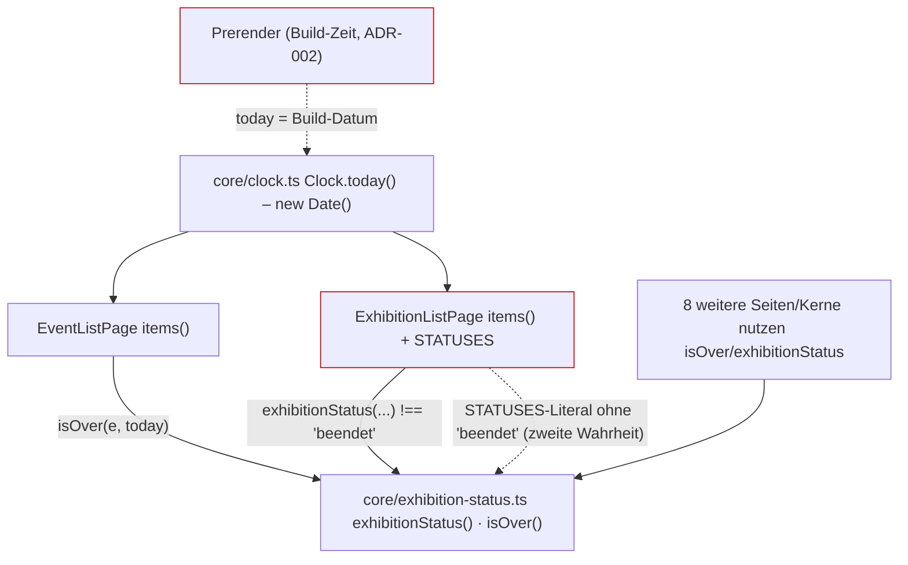
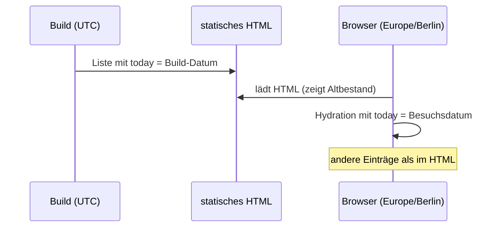

# Architektur-Analyse: Nur aktuelle Events und Ausstellungen (SERVICE-24-STORY-01)

**Ticket:** SERVICE-24  
**Analysiert:** 2026-11-10  
**Scope:** Änderungen der Story SERVICE-24-STORY-01 gegen `main` (ohne `docs/product/ideen/`): `web/src/app/pages/event-list/*`, `web/src/app/pages/exhibition-list/*`, `docs/ears/web/aktualitaet.md`, `docs/contracts/gherkin/web/aktualitaet.feature`, `docs/quality/web/aktualitaet.md`  
**Status:** Entwurf – wartet auf Abnahme  
**Berücksichtigte ADRs / Gherkin:** ADR-002 (Zoneless, Prerendering, `core/`/`shared/`, Signals), ADR-015 (Badge-Zeile), ADR-025 (globaler Filter), ADR-024 (Proposed, nicht betroffen) / `web/aktualitaet.feature`, `web/ausstellungen.feature`, `web/events.feature`

Hinweis zur Abweichung vom Skill: Die Skill-Pfade (`context/AI_CONTEXT.md`, `docs/product/contracts/…`, `docs/product/planning/…`) existieren in diesem Repository nicht; verwendet wurden `docs/contracts/`, `docs/planning/` und die ADRs in `docs/architecture/` (ADR-001 bis ADR-026). Die im Skill genannten ADR-Nummern (z. B. ADR-004 Signals, ADR-022 Parent/Child) passen nicht zu diesem Projekt; Maßstab ist der tatsächliche Inhalt der ADRs.

---

## 1. Executive Summary

| Kriterium | Bewertung |
|---|---|
| Gesamtarchitektur-Score | 7 / 10 |
| Architektur-Reifegrad | Hoch |
| Komponentenorientierung | Stark |
| Wartbarkeit | Mittel bis Hoch |
| Testbarkeit | Hoch |
| Technische Schuld | Gering |
| ADR-Konformität | vollständig konform (kein Verstoß); ein ADR-Bedarf (ARCH-02) |

Die Änderung ist klein, passt in die bestehende Struktur (Standalone-Seiten, Signals/`computed`, Zeitquelle `Clock`, Statuslogik in `core/exhibition-status.ts`) und ist durch Tests mit festem Referenzdatum gut abgesichert. Die Spezifikation ist ticketunabhängig und vollständig verknüpft (EARS ↔ Gherkin ↔ Quality). Zwei Schwächen: Die Regel „aktuell“ ist in den beiden Listen auf zwei unterschiedliche Arten umgesetzt (`isOver` vs. `status !== 'beendet'` plus handgepflegte Statusliste), obwohl Q-REL-4 „keine zweite Berechnung“ fordert. Außerdem ist „heute“ wegen des Prerenderings (ADR-002) ein Build-Zeitpunkt; das Verschwinden beendeter Einträge hängt damit am Deploy-Rhythmus und kann Hydration-Abweichungen erzeugen. Dafür ist eine bewusste Entscheidung nötig.

### Überblick Architektur (Scope)

---

## 2. Analyse nach Kategorien

### Komponentenarchitektur

- **Bewertung:** Stark
- **Beobachtungen:** Beide Seiten bleiben schlanke Smart-Komponenten ohne Datenzugriff außerhalb von `DataService` (`event-list.ts:21`, `exhibition-list.ts:88`). Die Entfernung der Template-Methode `isOver` und des „Beendet“-Badges in `event-list.html` (Diff) verkleinert die Komponente. Wiederverwendung `app-exhibition-badges` (ADR-015) und `GlobalFilterControl` (ADR-025) bleiben erhalten.
- **Architektur-Risiko:** Gering.
- **Skalierungsrisiko:** Jede weitere „aktuelle“ Liste müsste die Regel erneut verdrahten (ARCH-01).
- **Wartbarkeitsauswirkung:** Positiv (weniger Template-Logik).

### State Management & Reaktivität

- **Bewertung:** Stark
- **Beobachtungen:** Reine `computed`-Ableitungen (`event-list.ts:42-51`, `exhibition-list.ts:101-110`), `toSignal` für Query-Parameter (`exhibition-list.ts:92`), keine `effect`s, zoneless-kompatibel (ADR-002). `today` wird einmal bei der Konstruktion eingefroren (`event-list.ts:29`, `exhibition-list.ts:91`): bei lange offener Seite über Mitternacht ändert sich die Liste nicht (Annahme: akzeptabel, Seite ist kurzlebig).
- **Architektur-Risiko:** Siehe ARCH-02 (Build- vs. Laufzeit).
- **Skalierungsrisiko:** Gering.
- **Wartbarkeitsauswirkung:** Positiv.

### Service-Schicht

- **Bewertung:** Stark
- **Beobachtungen:** Fachregel „Status/Ende“ liegt als reine Funktion in `core/exhibition-status.ts:16-25` (ADR-002: Gemeinsames unter `core/`). Keine neue Schicht, kein neuer Dienst, kein God-Service. Es fehlt lediglich ein benanntes Prädikat für „aktuell“ (ARCH-01).
- **Architektur-Risiko:** Gering.
- **Skalierungsrisiko:** Gering.
- **Wartbarkeitsauswirkung:** Neutral.

### Struktur & Abhängigkeiten

- **Bewertung:** Stark
- **Beobachtungen:** Feature-Ordner `pages/<seite>/` unverändert; keine neuen Importe zwischen Seiten; beide Seiten hängen nur von `core/` und `shared/` ab. Die Spezifikation liegt in den vorgesehenen Ordnern, ohne Ticket-IDs (AGENTS.md); EARS-Verweise auf ADR-002 tragen, weil keine neue Entscheidung getroffen wurde.
- **Architektur-Risiko:** Gering.
- **Skalierungsrisiko:** Gering.
- **Wartbarkeitsauswirkung:** Positiv.

### Kopplung & Kohäsion

- **Bewertung:** Mittel bis Stark
- **Beobachtungen:** Hohe Kohäsion je Seite. Kopplung an die konkrete Statuswert-Zeichenkette `'beendet'` an zwei Stellen der Ausstellungsliste (`exhibition-list.ts:79`, `:108`) und an `isOver` in der Eventliste (`event-list.ts:48`) – drei Stellen für dieselbe Regel (ARCH-01). Testbarkeit hoch: `Clock` ist ersetzbar, Grenzfälle (gestern/heute/morgen) sind in den Specs belegt (ADR-konform, Q-REL-4).
- **Architektur-Risiko:** Gering.
- **Skalierungsrisiko:** Mittel (siehe ARCH-01).
- **Wartbarkeitsauswirkung:** Leicht negativ durch Doppelpflege.

---

## 3. Prinzipien

### SRP – Score 8
- **Eingehalten:** Seiten bauen Ansicht, `core/exhibition-status.ts` entscheidet Status.
- **Verletzt:** –
- **Auswirkung:** Gut testbar.

### OCP – Score 6
- **Eingehalten:** Filterkette erweiterbar um weitere Prädikate (UND).
- **Verletzt:** Neue Listen/Status erfordern Änderungen an `STATUSES` und am Zusatzfilter (`exhibition-list.ts:79`, `:108`).
- **Auswirkung:** Erweiterbarkeit.

### LSP – Score 9
- Nicht berührt; keine Vererbung. Kein Befund.

### ISP – Score 8
- **Eingehalten:** `isOver`/`exhibitionStatus` nehmen `Pick<…, 'endDate'>` bzw. `Pick<…, 'startDate'|'endDate'>` (`exhibition-status.ts:16`, `:23`).

### DIP – Score 8
- **Eingehalten:** Zeit über injizierbares `Clock` (`event-list.ts:29`), Daten über `DataService`.
- **Verletzt:** `Clock` liest `new Date()` direkt (`clock.ts:7`); das ist der Hebel für ARCH-02.

### Separation of Concerns – Score 7
- **Eingehalten:** Anzeige im Template, Regel in `core/`.
- **Verletzt:** Teile der Aktualitätsregel stehen im Seitencode statt in `core/` (ARCH-01).

### Law of Demeter – Score 8
- Keine tiefen Ketten; `venues.get(e.venueId)?.name` ist unkritisch.

---

## 4. Identifizierte Architektur-Schwächen

### ARCH-01: Aktualitätsregel auf zwei Wegen und handgepflegter Statusliste umgesetzt

- **Priorität:** Mittel
- **Betroffene Stelle:** `web/src/app/pages/event-list/event-list.ts:48`, `web/src/app/pages/exhibition-list/exhibition-list.ts:79`, `:108`
- **Beschreibung:** Eventliste nutzt `isOver(e, today)`, die Ausstellungsliste `item.status !== 'beendet'`, und `STATUSES` ist als separates Literal ohne „beendet“ gepflegt. Beides ist heute äquivalent, aber nicht strukturell verbunden. Q-REL-4 verlangt „dieselbe Regel … keine zweite Berechnung“ – dem Geist nach nur teilweise erfüllt (gleiche Quelle `exhibition-status.ts`, aber zwei Ausdrücke). Der Filter `item.status !== 'beendet'` neben `STATUSES` ist redundant zur Menge der anbietbaren Status.
  Reste der Umstellung: Die Meta-Description der Ausstellungsliste nennt weiterhin „beendet“ als Status (`exhibition-list.ts:113`), obwohl die Liste Beendete nicht mehr zeigt; `today` ist in der Eventliste noch `protected` (`event-list.ts:29`), wird aber im Template nicht mehr gebraucht.
- **Verletztes Prinzip / ADR:** DRY auf struktureller Ebene, OCP, SoC; Q-REL-4 (Geist). Kein ADR-Verstoß.
- **Konsequenz:** Ändert sich die Regel (z. B. Karenzfrist von N Tagen) oder kommt ein Status hinzu, laufen beide Listen auseinander, ohne dass ein Test es zwingend merkt (Specs prüfen nur Grenzfälle je Liste).
- **Langfristiges Risiko:** Schleichende Inkonsistenz bei weiteren „nur aktuell“-Listen (ACT-UB-4 nennt bereits Orte, Kalender mit eigenen Ausprägungen).

### ARCH-02: „heute“ ist bei vorab erzeugten Seiten der Build-Zeitpunkt

- **Priorität:** Mittel (Annahme: Veröffentlichung nur per Deploy, kein zeitgesteuerter Build gefunden)
- **Betroffene Stelle:** `web/src/app/core/clock.ts:7`; `web/src/app/app.routes.server.ts:16` (`'**'` → `RenderMode.Prerender`); `event-list.ts:29`, `exhibition-list.ts:91`
- **Beschreibung:** `/events` und `/exhibitions` werden gemäß ADR-002 statisch vorab erzeugt; `Clock.today()` liefert dabei das Build-Datum (Zeitzone des Builders). Im Browser berechnet die Hydration mit dem Datum des Besuchs. Die ausgelieferte HTML-Datei enthält also Einträge, die am Besuchstag schon beendet sind, bis zum nächsten Deploy (Suchmaschinen, JS-lose Aufrufe). Beim Hydrieren weicht die Ansicht ab (Hydration-Mismatch/Neuaufbau des DOM). Vor der Story war der Effekt auf ein Badge beschränkt; jetzt entscheidet er über Sichtbarkeit und wirkt auf ACT-UB-1 und Q-REL-4 („weder nach Zeitzone“).
- **Verletztes Prinzip / ADR:** Kein ADR-Verstoß; ADR-002 regelt „heute“ nicht. Q-REL-4 deckt nur die Entscheidungslogik, nicht den Zeitpunkt der Auswertung.
- **Konsequenz:** Kurzzeitig falsche Listen im statischen HTML; potenzielle Konsolen-Warnungen/Flackern bei Hydration; Zeitzonen-Grenzfälle um Mitternacht (UTC-Build vs. Europe/Berlin-Besucher).
- **Langfristiges Risiko:** Wächst mit der Zahl zeitabhängiger Ansichten.

## 5. Skalierbarkeit & Risiken

- **Wachsende Feature-Anforderungen:** Weitere zeitabhängige Listen (Festivals, Veranstalter) würden die Regel ein drittes Mal verdrahten (ARCH-01).
- **Team-Wachstum:** Gering; Regel ist durch EARS/Gherkin/Quality dokumentiert.
- **Zunehmende fachliche Komplexität:** Karenzfristen oder „heute“ in fester Zeitzone benötigen genau einen Ort (ARCH-01, ARCH-02).

### Top 5 architektonische Risiken

1. Statisches HTML zeigt nach Mitternacht/ohne Deploy beendete Einträge – ARCH-02
2. Hydration-Abweichung zwischen Build- und Besuchsdatum – ARCH-02
3. Auseinanderlaufende Aktualitätsregel – ARCH-01
4. Zeitzone von `new Date()` (lokale Zeit des Builders/Browsers) – ARCH-02
5. Eingefrorenes `today` bei sehr langer Sitzung (niedrig, Annahme)

### Alternative Ansätze (zu ARCH-02, nur Optionen)

- **A: Status quo + zeitgesteuerter Deploy (täglicher Build kurz nach Mitternacht Europe/Berlin).** Wenig Aufwand, hält HTML aktuell; Hydration bleibt zwischen Build und Besuch am selben Tag stabil. Nachteil: zusätzlicher CI-Job, Restlücke bis zum Build.
- **B: Listen nur im Browser auswerten (Prerender der Hülle, Liste clientseitig, z. B. erst nach Hydration).** Immer korrekt; Nachteil: SEO-Inhalt der Liste fehlt im HTML, Verzicht auf Teile von Q-SEO.
- **C: Feste Zeitzone Europe/Berlin in `Clock` plus A.** Behebt Zeitzonenabweichung; Nachteil: `Intl`-Aufruf in `Clock`, Tests bleiben ersetzbar.

## 6. Positive Aspekte

- Spezifikation vollständig, ticketunabhängig, Grenzfalltabelle für Stichtage (Q-REL-4).
- Tests mit festem Referenzdatum und Grenzfällen (`event-list.spec.ts`, `exhibition-list.spec.ts`), inklusive unbekanntem URL-Wert (ACT-UN-1) und leerem Zustand (ACT-ST-1).
- Ungültige Adresswerte werden still zu „kein Filter“ (`exhibition-list.ts:97-100`), konsistent zu `selectedType`.
- Detailseiten bleiben unverändert (ACT-UB-3); Änderung bleibt auf zwei Seiten begrenzt.

## 7. Bewusst nicht gemeldet

- Mehrere Query-Parameter-Handler (`router.navigate`) statt zentralem Filterdienst: durch ADR-025 (Query-Parameter für lokale Filter bleiben) gedeckt.
- `toSignal` über `ActivatedRoute` in der Ausstellungsliste vs. `input()` in der Eventliste: unterschiedlicher Stil, vorbestehend, kein Bezug zur Story.
- Kein NgModule/Zone: durch ADR-002 vorgegeben.

## 8. Abgeleitete Tasks (Top-Maßnahmen)

| Task | Titel | Priorität | Aufwand | Befunde | Erwartete Wirkung |
|---|---|---|---|---|---|
| [TASK-04](TASK-04-aktualitaetsregel-zentralisieren.md) | Aktualitätsregel als ein Prädikat in `core/` bündeln, Reste aufräumen | Medium | ~1 h | ARCH-01 | Eine Regel für alle Listen, Q-REL-4 strukturell erfüllt |
| [TASK-05](TASK-05-adr-stichtag-bei-prerendering.md) | ADR zum Stichtag („heute“) bei vorab erzeugten Seiten | Medium | ~2 h | ARCH-02 | Bewusste Entscheidung über Aktualität im statischen HTML |

## 9. Nicht bewertbar

- Deploy-Rhythmus und Zeitzone des CI-Builders: `.github/workflows` enthält keinen zeitgesteuerten Build, Veröffentlichungsprozess außerhalb des Repositories nicht geprüft (Grundlage von ARCH-02 ist daher eine Annahme).
- Tatsächliches Hydration-Verhalten wurde nicht im Browser verifiziert, sondern aus Code (`Clock`, Prerender-Konfiguration) abgeleitet.
- Zusätzliche Befunde zu Orts-, Personen- und Kalenderseiten (ACT-UB-4) liegen außerhalb des Scopes (Story 02).
